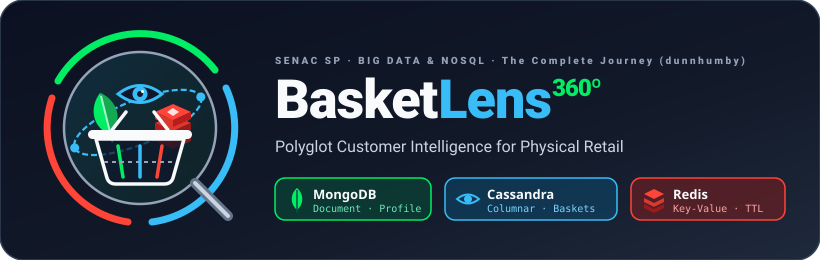

<p align="center">
  
</p>

# BasketLens 360º — Inteligência Poliglota do Cliente para Varejo Físico

**BasketLens** é uma solução de **Persistência Poliglota** desenvolvida para o **Case 7 (*Fidelidade dunnhumby — Visão 360º do Cliente com Três Bancos*)** da disciplina **Big Data e NoSQL: Soluções de Armazenamento Inovadoras (BDDB)**, combinando **MongoDB 8.0**, **Apache Cassandra 5.0**, **Redis 7.4** e **Python + Polars** sobre a base oficial **dunnhumby — The Complete Journey** (~847 MB, 6,27 milhões de registros em 8 arquivos CSV).

---

## 1. Documentação Oficial e Entregáveis da Rubrica

| Documento / Artefato | Conteúdo Principal | Critério da Rubrica Atendido |
|:---|:---|:---|
| [**`docs/ARCHITECTURE.md`**](docs/ARCHITECTURE.md) | Diagramas da arquitetura poliglota e dos dois modos operacionais (**Modo A Batch** vs. **Modo B Event Replay**), justificativas de modelagem (MongoDB, Cassandra e Redis), matriz **CAP/Consistência** e **Análise Crítica** (*"Onde entraria um grafo (Neo4j)?"* + evolução para Kubernetes). | Arquitetura e Modelagem Justificadas (12 pts) + Análise Crítica (8 pts) |
| [**`docs/BUSINESS_ANSWERS.md`**](docs/BUSINESS_ANSWERS.md) | Respostas executivas e técnicas comentadas para as **3 perguntas obrigatórias de negócio** + **consultas bônus de Trade Marketing**, com planos `explain("executionStats")`, tabelas consolidadas das 801 famílias demográficas e benchmark de Cache-Aside. | Implementação Funcional com Dados Reais e Consultas (15 pts) + Apresentação (10 pts) |
| [**`docs/dunnhumby_The-Complete-Journey-User-Guide.pdf`**](docs/dunnhumby_The-Complete-Journey-User-Guide.pdf) | Guia oficial de referência da dunnhumby (dicionário das 8 tabelas, estudo de caso **John Smith `household_key = 208`** e fórmulas de preço/desconto). | Dicionário Oficial de Dados |

---

## 2. Arquitetura e Infraestrutura Local (`docker-compose.yml`)

Toda a infraestrutura roda 100% localmente via Docker Compose com versões fixadas (*pinned versions*), *healthchecks* nativos e **3 interfaces Web pré-configuradas (Zero Config / Sem Login)**:

| Serviço | Imagem Docker | Porta do Banco | Web UI Dedicada | URL da Web UI | Papel no BasketLens |
|:---|:---|:---:|:---|:---|:---|
| **MongoDB** | `mongo:8.0.4` | `localhost:27017` | `mongo-express` | **`http://localhost:8081`** | Coleção `households` (2.500 perfis 360º: 801 com `demographics` + 1.699 sem `demographics`, `behavior_summary` e `recent_baskets` com `$slice: -5`). |
| **Apache Cassandra** | `cassandra:5.0.2` | `localhost:9042` | `cassandra-web` | **`http://localhost:3000`** | Keyspace `basketlens` com 4 tabelas orientadas à consulta (`transactions_by_household`, `transactions_by_household_product`, `sales_by_product_week`, `causal_promotions_by_store_week`). |
| **Redis** | `redis:7.4.2-alpine` | `localhost:6379` | `redis-commander` | **`http://localhost:8082`** | Campanhas e cupons ativos com **TTL** proporcional à vigência (`campanha:{id}`, `cupom:{upc}`), elegibilidade (`household:{id}:campaigns`), Cache-Aside (`profile:{id}`) e vitrines semanais. |

---

## 3. Como Executar o Projeto Passo a Passo

### 3.1 Criar o Ambiente Virtual Python (`.venv`) e Instalar as Dependências
Na raiz do repositório, crie o ambiente virtual isolado `.venv`, ative-o e instale o pacote `basketlens` em modo editável junto com todas as dependências de execução e desenvolvimento (`polars`, `pymongo`, `cassandra-driver`, `redis`, `jupyterlab`, `pytest`, etc.):

```bash
# 1. Criar o ambiente virtual .venv (requer Python 3.11+)
python3 -m venv .venv

# 2. Ativar o ambiente virtual
source .venv/bin/activate          # Linux / macOS
# .venv\Scripts\activate           # Windows (PowerShell / CMD)

# 3. Atualizar o pip e instalar o projeto + dependências (.[dev])
pip install --upgrade pip
pip install -e ".[dev]"

# 4. (Opcional) Registrar o kernel do .venv para uso no JupyterLab / VS Code
python -m ipykernel install --user --name basketlens --display-name "Python (.venv BasketLens)"
```

### 3.2 Subir a Infraestrutura Docker Compose
```bash
cp .env.example .env
docker compose up -d
docker compose ps
```
> O Cassandra leva cerca de 35–50 segundos para concluir o *bootstrap* inicial até atingir `healthy`. As Web UIs sobem automaticamente em `http://localhost:8081` (Mongo Express), `http://localhost:3000` (Cassandra Web) e `http://localhost:8082` (Redis Commander).

### 3.3 Verificar Conexões e Inicializar Schemas/Índices
```bash
.venv/bin/python -c "from basketlens import check_all_connections, initialize_all_schemas; print(check_all_connections()); print(initialize_all_schemas())"
```

---

## 4. Os Dois Modos Operacionais (`Modo A` e `Modo B`)

### Modo A — Carga Histórica Completa (`cutoff_day = 711`, `reference_day = 650`)
Processa os arquivos CSV *out-of-core* via Polars (`scan_csv` + `read_csv_batched`) sem carregar o dataset inteiro em memória:
```python
from basketlens.ingestion import run_full_ingestion

summary = run_full_ingestion(cutoff_day=711, reference_day=650, seconds_per_day=5)
print(summary)
```

### Modo B — Operação Dia a Dia / Event Replay (`DAY = 649 .. 657`)
Simula a operação diária da rede varejista passo a passo a partir da véspera do Dia 650, demonstrando o checkout de **John Smith (`household_key = 208`)**, o resgate do cupom `51800000050` no Dia 654, a rotação `$slice: -5` no MongoDB, a invalidação `DEL profile:208` e a expiração por **TTL** da Campanha 22 após o Dia 656:
```python
from basketlens.replay import prepare_replay_baseline, replay_range

prepare_replay_baseline(cutoff_day=649, seconds_per_day=5)
logs = replay_range(start_day=650, end_day=657, seconds_per_day=5, watch_household=208)
```

### Consulta Integrada 360º e Perguntas de Negócio (`basketlens.queries`)
```python
from basketlens.queries import (
    build_360_view,
    get_active_campaigns_for_household,
    get_avg_weekly_spend_by_demographic,
    get_household_profile_and_recent_history,
    get_product_causal_promotion_lift,
)

view_208 = build_360_view(household_key=208, limit_transactions=20)
q1 = get_household_profile_and_recent_history(household_key=208, limit=20)
q2 = get_active_campaigns_for_household(household_key=208)
q3_age = get_avg_weekly_spend_by_demographic("classification_1")
q3_income = get_avg_weekly_spend_by_demographic("classification_3")
lift_72717 = get_product_causal_promotion_lift(product_id=72717)
```

---

## 5. Roteiro dos 4 Notebooks Demonstrativos (`notebooks/`)

Todos os 4 notebooks estão pré-executados e prontos para inspeção ou reexecução ao vivo:

1. [**`notebooks/01_eda_and_data_quality.ipynb`**](notebooks/01_eda_and_data_quality.ipynb) — **EDA Out-of-Core e Qualidade de Dados com Polars**: inventário dos 8 CSVs (6,27M linhas), prova de que apenas 801 de 2.500 domicílios possuem `hh_demographic.csv`, inspeção dos códigos alfanuméricos de `causal_data.csv` e rastreamento do caso de estudo `household_key = 208`.
2. [**`notebooks/02_full_ingestion_setup.ipynb`**](notebooks/02_full_ingestion_setup.ipynb) — **Modo A (Ingestão Poliglota Completa até `DAY = 711`)**: criação idempotente dos schemas/índices, carga dos 2.500 documentos no MongoDB, 4 tabelas CQL no Cassandra e estado ativo no Redis, seguida de auditoria `explain("executionStats")` comprovando `EXPRESS_IXSCAN` / `IXSCAN`.
3. [**`notebooks/03_event_replay_streaming.ipynb`**](notebooks/03_event_replay_streaming.ipynb) — **Modo B (Event Replay Dia a Dia: `DAY = 649 .. 657`)**: simulação operacional acompanhando John Smith (`#208`), compra e resgate do cupom `51800000050` no Dia 654, rotação `$slice: -5`, invalidação `DEL profile:208` e expiração automática da Campanha 22 no Dia 657.
4. [**`notebooks/04_polyglot_360_analytics.ipynb`**](notebooks/04_polyglot_360_analytics.ipynb) — **Visão 360º e Respostas Executivas às 3 Perguntas + Bônus Trade Marketing**: benchmark Cache-Miss vs. Cache-Hit e respostas completas às Perguntas 1, 2, 3 (`classification_1` e `classification_3`) e lift promocional de gôndola/tabloide.

---

## 6. Testes Automatizados (`pytest`)

Para executar toda a suíte de validação fim a fim (configuração, conexões, schemas/índices, ingestão Polars, Event Replay, consultas 360º e validação dos entregáveis documentais):
```bash
.venv/bin/pytest -v
```

---

## 7. Fonte dos Dados e Citação Oficial de Licença

Este projeto utiliza o dataset público **dunnhumby — The Complete Journey**, disponibilizado gratuitamente pela **dunnhumby** para fins acadêmicos, científicos e educacionais mediante aceite dos termos de uso oficiais:

- **Fonte Oficial:** dunnhumby Source Files — *The Complete Journey* (`https://www.dunnhumby.com/source-files/`)
- **Espelho Público:** Kaggle (`https://www.kaggle.com/datasets/frtgnn/dunnhumby-the-complete-journey`)
- **Citação Obrigatória:**
  > *dunnhumby (2023). "The Complete Journey: Retail Shopping Dataset & User Guide". Disponível em: https://www.dunnhumby.com/source-files/. Utilizado exclusivamente para fins acadêmicos na disciplina Big Data e NoSQL.*
