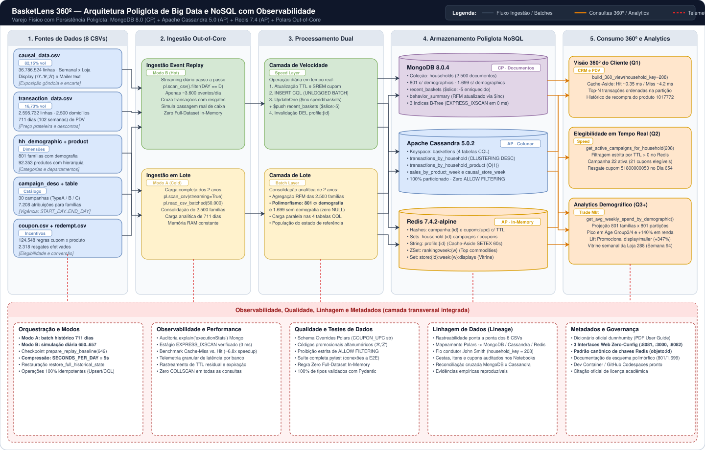

<p align="center">
  
</p>

# BasketLens 360º — Inteligência Poliglota do Cliente para Varejo Físico

**BasketLens** é uma solução de **Persistência Poliglota** desenvolvida para o **Case 7 (*Fidelidade dunnhumby — Visão 360º do Cliente com Três Bancos*)** da disciplina **Big Data e NoSQL: Soluções de Armazenamento Inovadoras (BDDB)**, combinando **MongoDB 8.0**, **Apache Cassandra 5.0**, **Redis 7.4** e **Python + Polars** sobre a base oficial **dunnhumby — The Complete Journey** (~847 MB, 6,27 milhões de registros em 8 arquivos CSV).

---

## 1. Sobre o Projeto e Contexto do Problema

No varejo alimentar físico moderno, programas de fidelidade geram simultaneamente **cadastros ricos e heterogêneos de clientes**, **bilhões de eventos imutáveis de passagem de caixa (PDV) e auditoria de gôndola/tabloide**, e **decisões de elegibilidade promocional em tempo real** no momento do checkout. Tentar atender a esses três padrões de acesso concorrentes com um único banco de dados relacional ou monolítico leva a gargalos clássicos: *joins* custosos para montar a tela de CRM, degradação de escrita em séries temporais massivas e *cron jobs* lentos para expirar campanhas e cupons vencidos.

O **BasketLens 360º** resolve esse trilema por meio de uma arquitetura de **Persistência Poliglota**, onde cada família NoSQL assume exatamente a carga de trabalho para a qual foi projetada:

1. **Agregado do Perfil 360º (`MongoDB 8.0` · Documentos BSON · `CP`):** armazena os **2.500 domicílios** da base em documentos coesos (`households`), combinando **Esquema Polimórfico** (acomodando naturalmente os **801 domicílios** com demografia mapeada e os **1.699** sem demografia, sem colunas `NULL`), **Subset Pattern** (mantendo apenas as 5 cestas mais recentes em `recent_baskets` via `$slice: -5`), **Extended Reference Pattern** (itens enriquecidos com departamento e categoria) e **Computed Pattern** (`behavior_summary` atualizado incrementalmente via `$inc`).
2. **Séries Temporais de Transações e Promoções Físicas (`Apache Cassandra 5.0` · Colunas Largas · `AP`):** absorve os eventos *append-only* de compras (`2,59 milhões` de linhas) e de exposição em display/tabloide (`36,78 milhões` de linhas) em **4 tabelas CQL modeladas pela consulta (*Query-Driven Modeling*)**, com ordenação física decrescente em disco (`CLUSTERING ORDER BY ... DESC`) e **zero uso de `ALLOW FILTERING`**.
3. **Camada de Velocidade, Elegibilidade e Cache (`Redis 7.4` · Chave-Valor em RAM · `AP`):** governa em sub-milissegundo quais campanhas e cupons estão ativos **agora** através de **TTL nativo** proporcional à janela de vigência (`campanha:{id}`, `cupom:{upc}`, `household:{id}:campaigns`, `household:{id}:coupons`), além de acelerar a leitura do perfil 360º via padrão **Cache-Aside** (`profile:{id}`) com invalidação ativa (`DEL`) a cada nova compra.

<p align="center">
  
</p>

### Engenharia *Out-of-Core* com Polars e Estudo de Caso Real (`John Smith #208`)
- **Regra Estrita *Zero Full-Dataset In-Memory*:** Toda a ingestão e simulação utiliza **Polars** em modo *lazy/streaming* (`pl.scan_csv(...).collect(engine="streaming")` e `pl.read_csv_batched`), processando centenas de megabytes e dezenas de milhões de registros com consumo constante de RAM.
- **Fio Condutor Empírico:** Toda a jornada analítica acompanha o cliente do estudo de caso oficial do guia da dunnhumby — **John Smith (`household_key = 208`)** — operando em **dois modos complementares**: **Modo A (Carga Histórica Completa `DAY 1..711`)** para análises globais de 2 anos e **Modo B (Event Replay Dia a Dia `DAY 649..657`)** para demonstrar em tempo real o checkout, o resgate do cupom `51800000050` no Dia 654, a rotação `$slice: -5`, a invalidação `DEL profile:208` e a expiração automática da Campanha 22 após o Dia 656.

---

## 2. As Bases de Dados (`dunnhumby — The Complete Journey`)

O dataset oficial **dunnhumby — The Complete Journey** acompanha todas as compras de **2.500 domicílios** compradores frequentes de uma rede varejista ao longo de **2 anos completos (711 dias / 102 semanas)** em **8 arquivos CSV** (~808 MiB / ~847 MB em disco). O dicionário oficial completo acompanha este repositório em [**`docs/dunnhumby_The-Complete-Journey-User-Guide.pdf`**](docs/dunnhumby_The-Complete-Journey-User-Guide.pdf).

### 2.1 Inventário dos 8 Arquivos CSV e Destino Poliglota

| Arquivo CSV | Linhas | Tamanho (`% Volume`) | Granularidade e Conteúdo Principal | Destino na Arquitetura Poliglota |
|:---|---:|---:|:---|:---|
| **`causal_data.csv`** | `36.786.524` | `663,62 MiB` (**`82,15%`**) | Auditoria semanal por `PRODUCT_ID`, `STORE_ID` e `WEEK_NO` indicando posição de gôndola (`display`) e destaque em encarte/tabloide (`mailer`). | **Cassandra** (`causal_promotions_by_store_week`) + **Redis** (`store:{id}:week:{w}:displays`) |
| **`transaction_data.csv`** | `2.595.732` | `135,18 MiB` (**`16,73%`**) | Linha de item por cesta (`BASKET_ID`), domicílio (`household_key`), dia (`DAY`), semana (`WEEK_NO`), loja, quantidade, valor líquido (`SALES_VALUE`) e descontos (`RETAIL_DISC`, `COUPON_DISC`, `COUPON_MATCH_DISC`). | **Cassandra** (`transactions_by_household`, `transactions_by_household_product`, `sales_by_product_week`) + **MongoDB** (`behavior_summary` e `recent_baskets`) |
| **`coupon.csv`** | `124.548` | `2,69 MiB` (`0,33%`) | Regras de elegibilidade vinculando código do cupom (`COUPON_UPC`), campanha (`CAMPAIGN`) e produtos elegíveis (`PRODUCT_ID`). | **Redis** (`campanha:{id}:coupons`, `cupom:{upc}`, `household:{id}:coupons`) |
| **`product.csv`** | `92.353` | `6,13 MiB` (`0,76%`) | Catálogo mercadológico (`PRODUCT_ID`, `DEPARTMENT`, `COMMODITY_DESC`, `SUB_COMMODITY_DESC`, `MANUFACTURER`, `BRAND`, `CURR_SIZE_OF_PRODUCT`). | **MongoDB** (*Extended Reference* nos itens de `recent_baskets`) + **Redis** (`ranking:week:{w}`) |
| **`campaign_table.csv`** | `7.208` | `0,09 MiB` (`0,01%`) | Histórico de disparos associando cada `household_key` às campanhas recebidas (`CAMPAIGN` e tipo `DESCRIPTION`). | **MongoDB** (`campaigns_received`) + **Redis** (`household:{id}:campaigns`) |
| **`coupon_redempt.csv`** | `2.318` | `0,05 MiB` (`0,01%`) | Registro de resgates efetivos de cupons (`household_key`, `DAY`, `COUPON_UPC`, `CAMPAIGN`). | **Redis** (baixa `SREM` em `household:{id}:coupons` e log em `redeemed_coupons`) |
| **`hh_demographic.csv`** | `801` | `0,04 MiB` (`0,01%`) | Perfil demográfico e socioeconômico de **801 domicílios** (`classification_1` Faixa Etária, `classification_2` Estado Civil, `classification_3` Renda, `HOMEOWNER_DESC`, `classification_4` Tamanho, `classification_5` Composição, `KID_CATEGORY_DESC`). | **MongoDB** (subdocumento polimórfico `demographics` presente apenas nos 801 domicílios) |
| **`campaign_desc.csv`** | `30` | `0,001 MiB` (`<0,01%`) | Catálogo das **30 campanhas** (`TypeA` personalizada, `TypeB` engatilhada, `TypeC` geral) com janela de vigência (`START_DAY` a `END_DAY`). | **Redis** (cálculo dinâmico de **TTL** nas chaves `campanha:{id}`) |

### 2.2 Três Armadilhas Reais do Dataset Descobertas na EDA (e Como o Projeto as Resolve)
1. **Cobertura Demográfica Incompleta (801 vs. 2.500 domicílios):** Embora `2.500` famílias comprem ativamente em `transaction_data.csv`, apenas **801 (32,04%)** possuem cadastro em `hh_demographic.csv`. Em vez de descartar 68% dos clientes ou criar tabelas cheias de `NULL`, o MongoDB armazena todos os 2.500 documentos em `households` e embute o objeto `demographics` exclusivamente nos 801 domicílios mapeados.
2. **Códigos Alfanuméricos em `causal_data.csv`:** As colunas `display` (`'0'..'9'`, `'A'`) e `mailer` (`'0'`, `'A'`, `'C'`, `'D'`, `'F'`, `'H'`, `'J'`, `'L'`, `'P'`, `'X'`, `'Z'`) contêm letras para representar posições especiais de loja e encarte. Por isso, o pipeline Polars aplica `CAUSAL_SCHEMA_OVERRIDES` explícito (`pl.Utf8`) e a tabela CQL `causal_promotions_by_store_week` tipa ambos os campos como `text`.
3. **Decomposição Oficial de Preço e Desconto (PDF pág. 3):** O valor `SALES_VALUE` já reflete o valor líquido recebido pelo varejista após o desconto de fidelidade (`RETAIL_DISC`, negativo) e o desconto de pareamento da loja (`COUPON_MATCH_DISC`, negativo), enquanto `COUPON_DISC` é reembolsado pelo fabricante:
   - $\text{Loyalty Card Unit Price} = \dfrac{\text{SALES\_VALUE} - (\text{RETAIL\_DISC} + \text{COUPON\_MATCH\_DISC})}{\text{QUANTITY}}$
   - $\text{Actual Customer Paid} = \text{SALES\_VALUE} + \text{COUPON\_DISC}$

---

## 3. Trilha da Documentação Oficial: Da Arquitetura às Respostas de Negócio

Para avaliar o projeto com todo o contexto técnico e de negócio, recomendamos seguir a leitura dos dois documentos principais na ordem abaixo:

### Passo 1 — Arquitetura Poliglota, Modelagem NoSQL e Análise Crítica $\rightarrow$ [**`docs/ARCHITECTURE.md`**](docs/ARCHITECTURE.md)
Antes de observar os números de saída, o documento [**`docs/ARCHITECTURE.md`**](docs/ARCHITECTURE.md) fundamenta **por que e como** cada banco foi modelado, contendo **4 diagramas padronizados em Draw.io SVG**:
- **Visão Geral e Camada de Observabilidade (`Seção 1`):** detalha o fluxo desde os 8 CSVs até as 5 raias da arquitetura e a camada transversal de observabilidade, linhagem, qualidade e metadados.
- **Dualidade Operacional Modo A vs. Modo B (`Seção 2`):** explica como o **Modo A (Batch 711 dias)** alimenta análises históricas de 2 anos e como o **Modo B (Event Replay `DAY 649..657`)** avança o relógio dia a dia para provar a expiração de **TTL**, a rotação `$slice: -5` e a invalidação **Cache-Aside** (`DEL profile:{id}`).
- **Justificativa de Modelagem por Banco (`Seção 3`):**
  - **MongoDB:** combinação de *Polymorphic Schema*, *Subset Pattern* (`$slice: -5`), *Extended Reference Pattern* e *Computed Pattern*, apoiados por 3 índices B-Tree (`idx_household_key_unique`, `idx_demographics_class1_class3`, `idx_behavior_avg_weekly_spend_desc`).
  - **Apache Cassandra:** desenho das 4 tabelas CQL (`transactions_by_household`, `transactions_by_household_product`, `sales_by_product_week`, `causal_promotions_by_store_week`), chaves de partição/clustering e eliminação total de `ALLOW FILTERING`.
  - **Redis:** convenção canônica de chaves (`objeto:id`), fórmula de TTL dinâmico e ciclo completo do **Cache-Aside**.
- **Matriz Teorema CAP e Consistência Ajustável (`Seção 4`):** *trade-offs* entre **CP** (MongoDB `w: "majority"`), **AP com consistência ajustável** (Cassandra `ONE` para leitura analítica vs. `LOCAL_QUORUM` com $R + W > N$ para escrita/leitura transacional em produção) e **AP em memória** (Redis com `TTL` e invalidação explícita).
- **Análise Crítica (`Seção 5`):** responde em profundidade ***"Onde entraria um banco de Grafos (Neo4j)?"*** (modelando nós `:Household`, `:Product`, `:Campaign`, `:Coupon` e arestas `[:BOUGHT_WITH]` para *Next-Best-Offer*, atribuição multi-salto e comunidades *Loualike* via GDS, além de justificar por que as 3 perguntas obrigatórias não exigem travessia de grafo) e projeta a **Evolução Corporativa em Kubernetes** (*Strimzi Kafka Operator* + *Outbox/CDC*, *K8ssandra Operator*, *MongoDB Operator*, *Redis Cluster Operator* e *Argo Workflows*).

### Passo 2 — Respostas Executivas e Evidências Empíricas $\rightarrow$ [**`docs/BUSINESS_ANSWERS.md`**](docs/BUSINESS_ANSWERS.md)
Com a arquitetura compreendida, o documento [**`docs/BUSINESS_ANSWERS.md`**](docs/BUSINESS_ANSWERS.md) apresenta as respostas executivas e técnicas extraídas diretamente dos 3 bancos para as **3 Perguntas Obrigatórias de Negócio + Consultas Bônus de Trade Marketing**:
1. **Pergunta 1 (*Qual o perfil e o histórico recente de um domicílio do programa?*):**
   - Evidência completa para **John Smith (`household_key = 208`)**: faixa etária `Age Group4`, renda `Level5`, casa própria (`Homeowner`), gasto acumulado de **`$4,296.33` em 140 cestas** (`$53.70/semana`), últimas 5 cestas embutidas no MongoDB e últimas 20 transações retornadas da partição física do Cassandra em ordem decrescente (além do histórico isolado das 7 compras do produto `1017772`).
   - Inclui auditoria `explain("executionStats")` comprovando estágio **`EXPRESS_IXSCAN` em `0 ms`** (`totalDocsExamined = 1`) e benchmark de **Cache-Aside** demonstrando redução de latência de `~4.28 ms` (*Cold Miss*) para `~0.62 ms` (*Warm Hit* na RAM do Redis — **ganho de até `6,85x`**).
2. **Pergunta 2 (*Quais campanhas estão ativas agora para um domicílio?*):**
   - Posicionando o relógio em `REFERENCE_DAY = 650`, comprova no Redis que das 8 campanhas históricas recebidas por John Smith (`[8, 13, 17, 18, 22, 26, 29, 30]`), apenas a **Campanha 22 (`TypeB`, vigência `DAY 624..656`)** está ativa (`TTL > 0`), oferecendo **21 cupons elegíveis** (incluindo o cupom `51800000050`).
   - Apresenta a tabela dia a dia do **Event Replay (`DAY 649..657`)**, provando o resgate do cupom `51800000050` na cesta `41531980403` no **Dia 654**, a baixa atômica via `SREM`, a invalidação `DEL profile:208` e a expiração automática da Campanha 22 no **Dia 657** (`TTL = -2`).
3. **Pergunta 3 (*Qual o gasto semanal médio por faixa demográfica?*):**
   - Consolida as **801 famílias demográficas** via projeção indexada no MongoDB (`idx_demographics_class1_class3`) combinada à leitura paralela das 801 partições no Cassandra (`execute_concurrent_with_args`, `ALLOW FILTERING = False`).
   - Demonstra que as faixas etárias intermediárias **`Age Group3` (`$90.19/semana`)** e **`Age Group4` (`$81.25/semana`)** concentram **60,18%** dos domicílios e o maior volume de compras, enquanto a segmentação por renda (`classification_3`) revela um salto de **`+140,9%`** no gasto semanal médio entre `Level2` (`$58.03/semana`) e `Level12` (`$139.80/semana`).
4. **Consultas Bônus de Trade Marketing (*Lift Promocional de Display & Mailer*):**
   - Reproduz exatamente o estudo de caso da página 4 do PDF oficial para o produto **`72717` na Semana 40** (`11 lojas` com encarte `'A'` e display traseiro `'2'`, reduzindo o preço de `$4.38` para `$1.88`), mede um **Promotional Lift de `+347,56%`** na receita semanal média do SKU de alto giro **`862349`** (`$86.96/semana` promovido vs. `$19.43/semana` sem promoção) e consulta em memória a vitrine semanal da Loja `288` na Semana `94` (`ZSET ranking:week:94` + `SET store:288:week:94:displays`).

### Resumo de Mapeamento da Rubrica Avaliativa

| Documento / Artefato | Conteúdo Principal | Critério da Rubrica Atendido |
|:---|:---|:---|
| [**`docs/ARCHITECTURE.md`**](docs/ARCHITECTURE.md) | 4 diagramas Draw.io SVG padronizados (Arquitetura Poliglota + Observabilidade, Modos A/B + Cache-Aside, Grafo Neo4j e Produção Kubernetes), justificativas de modelagem (MongoDB, Cassandra e Redis), matriz **CAP/Consistência** e **Análise Crítica**. | Arquitetura e Modelagem Justificadas (12 pts) + Análise Crítica (8 pts) |
| [**`docs/BUSINESS_ANSWERS.md`**](docs/BUSINESS_ANSWERS.md) | Respostas executivas e técnicas comentadas para as **3 perguntas obrigatórias de negócio** + **consultas bônus de Trade Marketing**, com planos `explain("executionStats")`, tabelas consolidadas das 801 famílias demográficas e benchmark de Cache-Aside. | Implementação Funcional com Dados Reais e Consultas (15 pts) + Apresentação (10 pts) |
| [**`docs/dunnhumby_The-Complete-Journey-User-Guide.pdf`**](docs/dunnhumby_The-Complete-Journey-User-Guide.pdf) | Guia oficial de referência da dunnhumby (dicionário das 8 tabelas, estudo de caso **John Smith `household_key = 208`** e fórmulas de preço/desconto). | Dicionário Oficial de Dados |

---

## 4. Arquitetura e Infraestrutura Local (`docker-compose.yml`)

Toda a infraestrutura roda 100% localmente via Docker Compose com versões fixadas (*pinned versions*), *healthchecks* nativos e **3 interfaces Web pré-configuradas (Zero Config / Sem Login)**:

| Serviço | Imagem Docker | Porta do Banco | Web UI Dedicada | URL da Web UI | Papel no BasketLens |
|:---|:---|:---:|:---|:---|:---|
| **MongoDB** | `mongo:8.0.4` | `localhost:27017` | `mongo-express` | **`http://localhost:8081`** | Coleção `households` (2.500 perfis 360º: 801 com `demographics` + 1.699 sem `demographics`, `behavior_summary` e `recent_baskets` com `$slice: -5`). |
| **Apache Cassandra** | `cassandra:5.0.2` | `localhost:9042` | `cassandra-web` | **`http://localhost:3000`** | Keyspace `basketlens` com 4 tabelas orientadas à consulta (`transactions_by_household`, `transactions_by_household_product`, `sales_by_product_week`, `causal_promotions_by_store_week`). |
| **Redis** | `redis:7.4.2-alpine` | `localhost:6379` | `redis-commander` | **`http://localhost:8082`** | Campanhas e cupons ativos com **TTL** proporcional à vigência (`campanha:{id}`, `cupom:{upc}`), elegibilidade (`household:{id}:campaigns`), Cache-Aside (`profile:{id}`) e vitrines semanais. |

---

## 5. Como Executar o Projeto Passo a Passo

### 5.1 Criar o Ambiente Virtual Python (`.venv`) e Instalar as Dependências
Na raiz do repositório, crie o ambiente virtual isolado `.venv`, ative-o e instale o pacote `basketlens` em modo editável junto com todas as dependências de execução e desenvolvimento (`polars`, `pymongo`, `cassandra-driver`, `redis`, `jupyterlab`, `pytest`, etc.):

```bash
# 1. Criar o ambiente virtual .venv (requer Python 3.11+)
python3 -m venv .venv

# 2. Ativar o ambiente virtual
source .venv/bin/activate          # Linux / macOS
# .venv\Scripts\activate           # Windows (PowerShell / CMD)

# 3. Atualizar o pip e instalar o projeto + dependências (.[dev])
pip install --upgrade pip
pip install -e ".[dev]"

# 4. (Opcional) Registrar o kernel do .venv para uso no JupyterLab / VS Code
python -m ipykernel install --user --name basketlens --display-name "Python (.venv BasketLens)"
```

### 5.2 Subir a Infraestrutura Docker Compose
```bash
cp .env.example .env
docker compose up -d
docker compose ps
```
> O Cassandra leva cerca de 35–50 segundos para concluir o *bootstrap* inicial até atingir `healthy`. As Web UIs sobem automaticamente em `http://localhost:8081` (Mongo Express), `http://localhost:3000` (Cassandra Web) e `http://localhost:8082` (Redis Commander).

### 5.3 Verificar Conexões e Inicializar Schemas/Índices
```bash
.venv/bin/python -c "from basketlens import check_all_connections, initialize_all_schemas; print(check_all_connections()); print(initialize_all_schemas())"
```

---

## 6. Os Dois Modos Operacionais (`Modo A` e `Modo B`)

### Modo A — Carga Histórica Completa (`cutoff_day = 711`, `reference_day = 650`)
Processa os arquivos CSV *out-of-core* via Polars (`scan_csv` + `read_csv_batched`) sem carregar o dataset inteiro em memória:
```python
from basketlens.ingestion import run_full_ingestion

summary = run_full_ingestion(cutoff_day=711, reference_day=650, seconds_per_day=5)
print(summary)
```

### Modo B — Operação Dia a Dia / Event Replay (`DAY = 649 .. 657`)
Simula a operação diária da rede varejista passo a passo a partir da véspera do Dia 650, demonstrando o checkout de **John Smith (`household_key = 208`)**, o resgate do cupom `51800000050` no Dia 654, a rotação `$slice: -5` no MongoDB, a invalidação `DEL profile:208` e a expiração por **TTL** da Campanha 22 após o Dia 656:
```python
from basketlens.replay import prepare_replay_baseline, replay_range

prepare_replay_baseline(cutoff_day=649, seconds_per_day=5)
logs = replay_range(start_day=650, end_day=657, seconds_per_day=5, watch_household=208)
```

### Consulta Integrada 360º e Perguntas de Negócio (`basketlens.queries`)
```python
from basketlens.queries import (
    build_360_view,
    get_active_campaigns_for_household,
    get_avg_weekly_spend_by_demographic,
    get_household_profile_and_recent_history,
    get_product_causal_promotion_lift,
)

view_208 = build_360_view(household_key=208, limit_transactions=20)
q1 = get_household_profile_and_recent_history(household_key=208, limit=20)
q2 = get_active_campaigns_for_household(household_key=208)
q3_age = get_avg_weekly_spend_by_demographic("classification_1")
q3_income = get_avg_weekly_spend_by_demographic("classification_3")
lift_72717 = get_product_causal_promotion_lift(product_id=72717)
```

---

## 7. Anatomia das Funções da Biblioteca `basketlens` (Interação com os Bancos de Dados)

Para facilitar a apresentação e o entendimento do código executado nos notebooks, cada função pública do pacote `basketlens` possui abaixo um **mini-diagrama ASCII** mostrando exatamente como ela interage com o **MongoDB**, o **Apache Cassandra**, o **Redis** e o motor **Polars**.

### 7.1 Conexões, Schemas e Planos de Execução (`basketlens.connections` & `basketlens.schemas`)

#### 1) `check_all_connections()` — *Healthcheck Poliglota (Notebook 02)*
Testa a conectividade ativa com os 3 motores NoSQL antes de iniciar cargas ou consultas:
```text
                        ┌───► [MongoDB :27017]   ── admin.command("ping") ─────────► True
check_all_connections() ├───► [Cassandra :9042]  ── SELECT release_version (local) ► True
                        └───► [Redis :6379]      ── PING ──────────────────────────► True
```

#### 2) `initialize_all_schemas()` — *Provisionamento Idempotente de Índices e Tabelas (Notebook 02)*
Garante que os índices B-Tree no MongoDB e o Keyspace + 4 tabelas CQL no Cassandra estejam criados:
```text
                         ┌───► [MongoDB]   ── Cria 3 índices B-Tree em db.households:
                         │                    • idx_household_key_unique ({household_key: 1}, unique)
                         │                    • idx_demographics_class1_class3
                         │                    • idx_behavior_avg_weekly_spend_desc
initialize_all_schemas() ├───► [Cassandra] ── CREATE KEYSPACE basketlens (SimpleStrategy, RF=1) + 4 tabelas:
                         │                    • transactions_by_household         (CLUSTERING DESC)
                         │                    • transactions_by_household_product (CLUSTERING DESC)
                         │                    • sales_by_product_week             (CLUSTERING DESC)
                         │                    • causal_promotions_by_store_week   (display/mailer text)
                         └───► [Redis]     ── Valida conexão (chaves efêmeras criadas sob demanda com TTL)
```

#### 3) `explain_query(collection, filter_spec, sort_spec)` — *Auditoria de Índice no MongoDB (Notebook 02)*
Extrai o plano de execução real (`executionStats`) para comprovar que nenhuma consulta realiza `COLLSCAN`:
```text
explain_query(filter, sort) ──► [MongoDB db.households]
                                  └──► .find(filter).sort(sort).explain("executionStats")
                                  ◄─── Retorna stage = "EXPRESS_IXSCAN" | "IXSCAN"
                                       (nReturned == totalKeysExamined == totalDocsExamined, 0 ms)
```

---

### 7.2 Ingestão Poliglota Out-of-Core — Modo A (`basketlens.ingestion`)

#### 4) `run_full_ingestion(cutoff_day=711, reference_day=650, seconds_per_day=5)` — *Orquestrador do Modo A (Notebook 02)*
Lê os 8 arquivos CSV via Polars (`scan_csv` e `read_csv_batched`) sem carregar a base inteira em RAM e popula os 3 bancos:
```text
[8 CSVs dunnhumby] ──► Polars scan_csv(streaming=True) / read_csv_batched(50_000)
                         │
                         ├──► 1. ingest_mongo_households() ──► [MongoDB db.households]
                         │       • Upsert em lote (bulk_write) dos 2.500 domicílios
                         │       • 801 c/ demographics + 1.699 sem demographics (Polimorfismo)
                         │       • behavior_summary (RFM) + recent_baskets ($slice: -5 enriquecido)
                         │
                         ├──► 2. ingest_cassandra_data()   ──► [Cassandra keyspace basketlens]
                         │       • Prepared Statements + UNLOGGED BATCH por chave de partição
                         │       • Popula as 4 tabelas CQL orientadas à consulta
                         │
                         └──► 3. ingest_redis_state()      ──► [Redis Pipeline em Memória]
                                 • Popula campanhas/cupons ativos em reference_day=650 com TTL
```

#### 5) `ingest_redis_state(reference_day=650, seconds_per_day=5)` & `clear_redis_namespace()` — *Estado Ativo e TTL no Redis (Notebooks 02 e 04)*
Materializa no Redis apenas as campanhas vigentes (`START_DAY <= ref_day <= END_DAY`), calculando o `TTL` proporcional aos dias restantes:
```text
[campaign_desc + campaign_table + coupon + coupon_redempt + transaction + causal CSVs]
   └──► Polars Lazy Filter (vigentes em reference_day = 650)
          └──► [Redis Pipeline]
                 ├── HSET + EXPIRE  campanha:{id}               (TTL = (END_DAY - ref_day) * seconds_per_day)
                 ├── SADD + EXPIRE  campanha:{id}:coupons       (COUPON_UPCs da campanha)
                 ├── HSET + EXPIRE  cupom:{upc}                 (regras e contagem de SKUs do cupom)
                 ├── SADD + EXPIRE  household:{id}:campaigns    (campanhas ativas do domicílio)
                 ├── SADD + EXPIRE  household:{id}:coupons      (cupons disponíveis ainda não resgatados)
                 └── ZADD / SADD    ranking:week:{w} & store:{id}:week:{w}:displays (TTL = 3600s)
```

---

### 7.3 Motor de Event Replay Dia a Dia — Modo B (`basketlens.replay`)

#### 6) `prepare_replay_baseline(cutoff_day=649, seconds_per_day=5)` — *Checkpoint de Véspera (Notebook 03)*
Posiciona os 3 bancos exatamente no fechamento do Dia 649 (véspera do Dia 650) para iniciar a simulação diária determinística:
```text
prepare_replay_baseline(cutoff_day=649)
  ├──► [Cassandra] TRUNCATE nas 4 tabelas + carrega eventos históricos até DAY <= 649
  ├──► [MongoDB]   Reconstrói os 2.500 perfis acumulados até DAY <= 649 (John Smith #208: last_day = 647)
  └──► [Redis]     Sincroniza campanhas ativas em DAY = 649 (Campanha 22 c/ TTL = 35s) + DEL profile:*
```

#### 7) `replay_day(day, seconds_per_day=5, watch_household=208)` — *Simulação de 1 Dia Operacional (Notebook 03)*
Filtra em *streaming* apenas os eventos de `DAY == day` (~3.600 linhas) e coordena a atualização nos 3 bancos em 4 passos:
```text
[Polars scan_csv().filter(DAY == D)]
        │
        ├──► PASSO 1 [Redis]     : Recalcula TTL = (END_DAY - D) * 5s das campanhas ativas,
        │                          remove campanhas vencidas (END_DAY < D) e processa resgates do dia:
        │                          SREM household:{id}:coupons <upc> + SADD household:{id}:redeemed_coupons
        │
        ├──► PASSO 2 [Cassandra] : INSERT (UNLOGGED BATCH) das compras do dia D em:
        │                          • transactions_by_household
        │                          • transactions_by_household_product
        │                          • sales_by_product_week
        │
        ├──► PASSO 3 [MongoDB]   : UpdateOne atômico por domicílio comprador no dia D:
        │                          • $inc  -> behavior_summary.total_spend / total_baskets
        │                          • $push -> recent_baskets com $each, $sort e $slice: -5 (mantém só 5!)
        │
        └──► PASSO 4 [Redis]     : DEL profile:{household_key}
                                   (invalida imediatamente o Cache-Aside para evitar leitura defasada!)
```

#### 8) `replay_range(start_day, end_day, ...)` & `restore_full_historical_state()` — *Janela de Replay e Restauração (Notebook 03)*
```text
replay_range(650..657) ──► replay_day(650) ──► ... ──► replay_day(654: #208 resgata cupom 51800000050)
                                                   ──► replay_day(657: Campanha 22 expira c/ TTL = -2)

restore_full_historical_state() ──► Restaura os 3 bancos para cutoff_day = 711 e reference_day = 650
```

---

### 7.4 Biblioteca de Consulta Poliglota e Visão 360º (`basketlens.queries`)

> **Importante:** Nenhuma função de `basketlens.queries` lê arquivos CSV. 100% das respostas vêm diretamente do **MongoDB**, **Cassandra** e **Redis**.

#### 9) `build_360_view(household_key=208, limit_transactions=20)` — *Visão 360º Unificada + Cache-Aside (Notebooks 03 e 04)*
Orquestra a leitura dos 3 bancos aplicando o padrão **Cache-Aside** sobre a chave `profile:{id}`:
```text
build_360_view(household_key=208)
  │
  ├──► 1. [Redis] GET profile:208
  │         ├─► Se CACHE HIT  : retorna o perfil JSON direto da RAM (~0.35 ms, source="redis")
  │         └─► Se CACHE MISS : consulta [MongoDB] db.households.find_one({household_key: 208})
  │                             via índice único EXPRESS_IXSCAN e grava [Redis] SETEX profile:208 60 <json>
  │
  ├──► 2. [Cassandra] SELECT ... FROM transactions_by_household WHERE household_key = 208 LIMIT 20
  │                   (leitura O(1) no topo da partição física já ordenada por week_no DESC, day DESC)
  │
  └──► 3. [Redis]     SMEMBERS household:208:campaigns + TTL/HGETALL campanha:{id} (filtra TTL > 0)
                      ◄── Retorna JSON 360º unificado + metadados de cache + latências em ms
```

#### 10) `benchmark_cache_aside_latency(household_key=208, iterations=15)` — *Benchmark Cache Miss vs. Cache Hit (Notebook 04)*
```text
Para i = 1..15:
  ├── Cold Cache Miss : [Redis] DEL profile:208 ──► [MongoDB] find_one({household_key: 208}) ──► [Redis] SETEX
  └── Warm Cache Hit  : [Redis] GET profile:208 ──► JSON retornado direto da memória RAM (sem ir ao MongoDB)
  ◄── Calcula avg_cache_miss_ms, avg_cache_hit_ms e speedup_factor (~3.2x a 6.8x mais rápido)
```

#### 11) `get_household_profile_and_recent_history(208)` & `get_household_product_history(208, 1017772)` — *Pergunta de Negócio 1 (Notebooks 03 e 04)*
```text
get_household_profile_and_recent_history(208)
  ├──► [Redis / MongoDB] Perfil demográfico + behavior_summary + recent_baskets (5 últimas cestas)
  └──► [Cassandra]       SELECT * FROM transactions_by_household WHERE household_key = 208 LIMIT N

get_household_product_history(household_key=208, product_id=1017772)
  └──► [Cassandra]       SELECT * FROM transactions_by_household_product
                         WHERE household_key = 208 AND product_id = 1017772
                         (usa PARTITION KEY composta ((household_key, product_id)) sem varrer outras compras!)
```

#### 12) `get_active_campaigns_for_household(household_key=208)` — *Pergunta de Negócio 2 (Notebooks 03 e 04)*
```text
get_active_campaigns_for_household(208)
  └──► [Redis]
         ├── 1. SMEMBERS household:208:campaigns ──► obtém campanhas atribuídas ao domicílio
         ├── 2. Para cada campanha: verifica TTL(campanha:{id}) > 0 + HGETALL campanha:{id}
         └── 3. Intersecta household:208:coupons ∩ campanha:22:coupons ──► HGETALL cupom:{upc}
                ◄── Retorna Campanha 22 (TypeB, TTL > 0) + 21 cupons elegíveis (incl. 51800000050)
```

#### 13) `get_avg_weekly_spend_by_demographic(classification_field)` — *Pergunta de Negócio 3 (Notebook 04)*
Cruza a projeção indexada dos **801 domicílios demográficos** no MongoDB com a leitura concorrente de partições no Cassandra:
```text
get_avg_weekly_spend_by_demographic("classification_1" | "classification_3")
  │
  ├──► 1. [MongoDB]   db.households.find({"demographics.classification_1": {"$exists": True}})
  │                   via índice composto idx_demographics_class1_class3 (nReturned = 801, zero COLLSCAN)
  │
  ├──► 2. [Cassandra] execute_concurrent_with_args em transactions_by_household:
  │                   "SELECT week_no, sales_value FROM transactions_by_household WHERE household_key = ?"
  │                   disparado para as 801 chaves de partição (allow_filtering_used = False!)
  │
  └──► 3. [Agregação] Consolida por faixa etária (Age Group1..6) ou nível de renda (Level1..12):
                      avg_weekly_spend = SUM(total_spend) / SUM(active_weeks)
```

#### 14) `get_product_causal_promotion_lift(product_id)` & `get_store_weekly_showcase(store_id, week_no)` — *Bônus de Trade Marketing (Notebook 04)*
```text
get_product_causal_promotion_lift(product_id = 72717 | 862349)
  ├──► [Cassandra] SELECT week_no, total_units, total_sales FROM sales_by_product_week WHERE product_id = ?
  ├──► [Cassandra] execute_concurrent_with_args em causal_promotions_by_store_week
  │                WHERE store_id = ? AND week_no = ? AND product_id = ? (verifica display != '0' ou mailer != '0')
  └──► Calcula receita semanal média COM promoção vs. SEM promoção (Lift = +347,56% no SKU 862349)

get_store_weekly_showcase(store_id=288, week_no=94)
  ├──► [Redis] ZREVRANGE ranking:week:94 0 9 WITHSCORES ──► Top categorias da semana por receita ($)
  └──► [Redis] SMEMBERS  store:288:week:94:displays     ──► 100 SKUs em display físico na loja 288
```

---

## 8. Roteiro dos 4 Notebooks Demonstrativos (`notebooks/`)

Todos os 4 notebooks estão pré-executados e prontos para inspeção ou reexecução ao vivo:

1. [**`notebooks/01_eda_and_data_quality.ipynb`**](notebooks/01_eda_and_data_quality.ipynb) — **EDA Out-of-Core e Qualidade de Dados com Polars**: inventário dos 8 CSVs (39,6M linhas totais / 808 MiB), prova de que apenas 801 de 2.500 domicílios possuem `hh_demographic.csv`, inspeção dos códigos alfanuméricos de `causal_data.csv` e rastreamento do caso de estudo `household_key = 208`.
2. [**`notebooks/02_full_ingestion_setup.ipynb`**](notebooks/02_full_ingestion_setup.ipynb) — **Modo A (Ingestão Poliglota Completa até `DAY = 711`)**: executa `check_all_connections()`, `initialize_all_schemas()`, `run_full_ingestion()` e `explain_query()`, comprovando a carga dos 2.500 documentos no MongoDB, 4 tabelas CQL no Cassandra, estado ativo no Redis e planos `EXPRESS_IXSCAN` / `IXSCAN`.
3. [**`notebooks/03_event_replay_streaming.ipynb`**](notebooks/03_event_replay_streaming.ipynb) — **Modo B (Event Replay Dia a Dia: `DAY = 649 .. 657`)**: executa `prepare_replay_baseline()`, `replay_range()`, `replay_day(654)`, `build_360_view(208)`, `get_household_product_history(208, 1017772)` e `restore_full_historical_state()`, demonstrando o resgate do cupom `51800000050`, a rotação `$slice: -5`, a invalidação `DEL profile:208` e a expiração automática da Campanha 22 no Dia 657.
4. [**`notebooks/04_polyglot_360_analytics.ipynb`**](notebooks/04_polyglot_360_analytics.ipynb) — **Visão 360º e Respostas Executivas às 3 Perguntas + Bônus Trade Marketing**: executa `build_360_view()`, `benchmark_cache_aside_latency()`, `get_household_profile_and_recent_history()`, `get_active_campaigns_for_household()`, `get_avg_weekly_spend_by_demographic()` (`classification_1` e `classification_3`), `get_product_causal_promotion_lift()` e `get_store_weekly_showcase()`.

---

## 9. Testes Automatizados (`pytest`)

Para executar toda a suíte de validação fim a fim (configuração, conexões, schemas/índices, ingestão Polars, Event Replay, consultas 360º e validação dos entregáveis documentais):
```bash
.venv/bin/pytest -v
```

---

## 10. Fonte dos Dados e Citação Oficial de Licença

Este projeto utiliza o dataset público **dunnhumby — The Complete Journey**, disponibilizado gratuitamente pela **dunnhumby** para fins acadêmicos, científicos e educacionais mediante aceite dos termos de uso oficiais:

- **Fonte Oficial:** dunnhumby Source Files — *The Complete Journey* (`https://www.dunnhumby.com/source-files/`)
- **Espelho Público:** Kaggle (`https://www.kaggle.com/datasets/frtgnn/dunnhumby-the-complete-journey`)
- **Citação Obrigatória:**
  > *dunnhumby (2023). "The Complete Journey: Retail Shopping Dataset & User Guide". Disponível em: https://www.dunnhumby.com/source-files/. Utilizado exclusivamente para fins acadêmicos na disciplina Big Data e NoSQL.*
