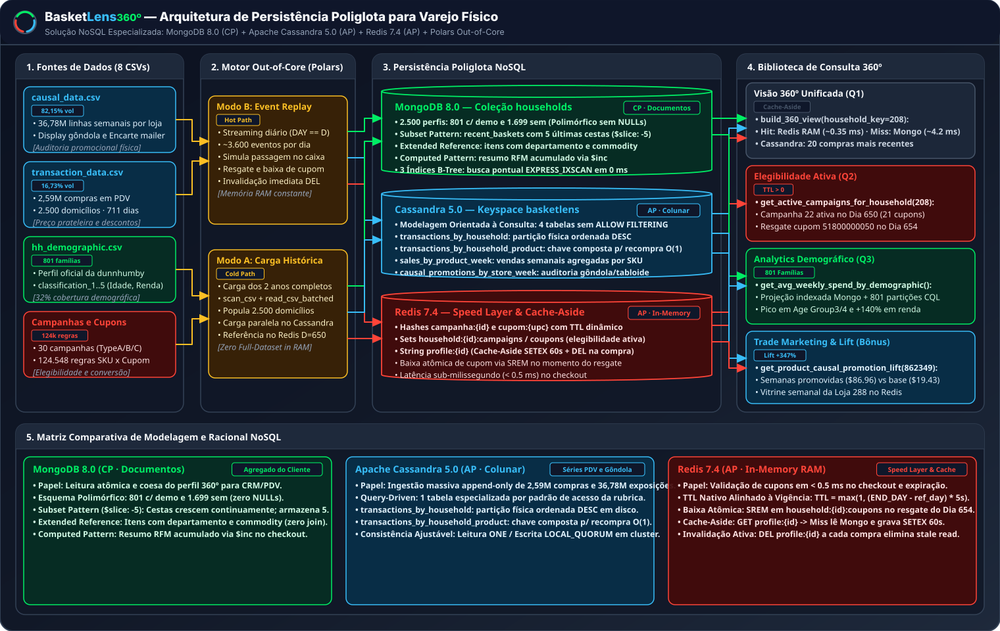
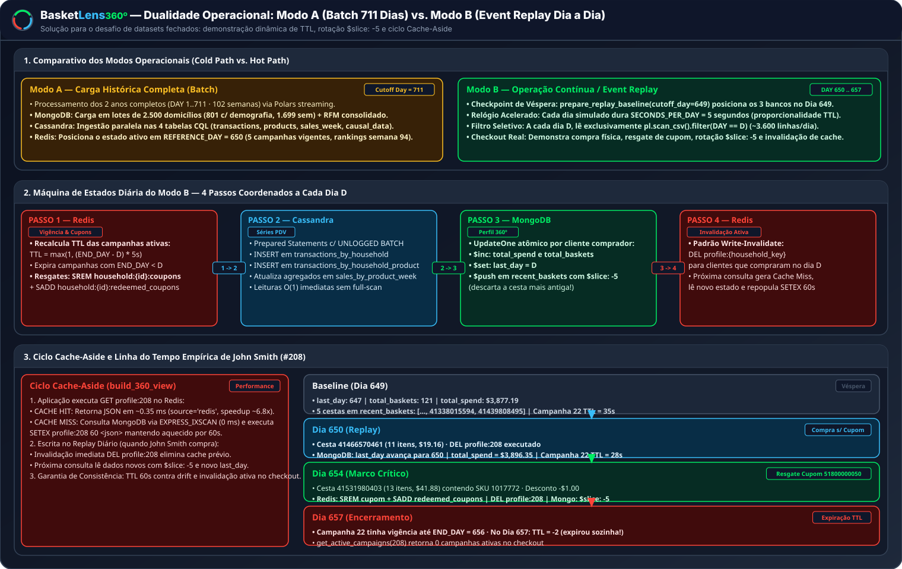
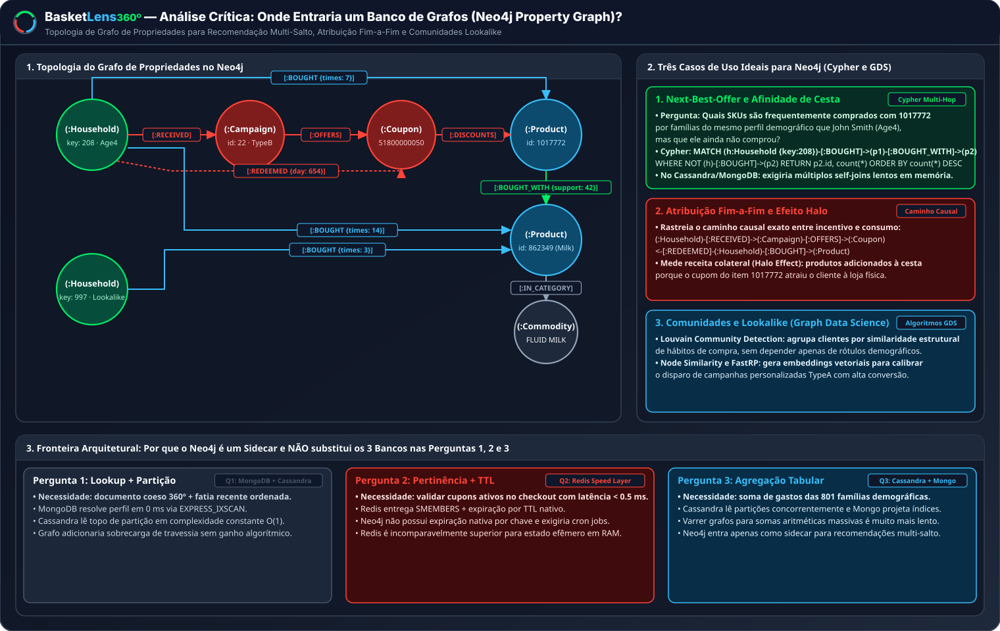
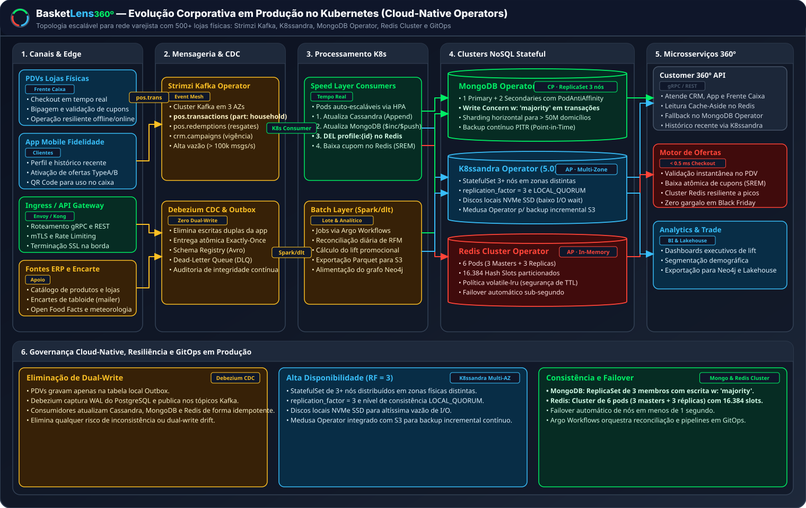

# BasketLens 360º — Arquitetura Poliglota, Modelagem NoSQL e Análise Crítica

> **Entregável Oficial — Aulas 6 e 8 (Arquitetura e Modelagem Justificadas + Análise Crítica)**  
> **Disciplina:** Big Data e NoSQL: Soluções de Armazenamento Inovadoras (BDDB)  
> **Professor:** Prof. Msc. Pedro Ernesto da Silva Souza  
> **Case 7:** Fidelidade *dunnhumby — The Complete Journey* (Visão 360º com MongoDB, Cassandra e Redis)  

---

## 1. Visão Geral da Arquitetura e as 3 Realidades Físicas do Dataset

O **BasketLens 360º** implementa uma arquitetura de **Persistência Poliglota** desenvolvida para resolver os desafios de engenharia de dados do varejo alimentar físico com programa de fidelidade. A plataforma orquestra três motores NoSQL especializados (**MongoDB 8.0**, **Apache Cassandra 5.0** e **Redis 7.4**) alimentados por um motor de processamento *out-of-core* em Python + **Polars**:

  

Toda a modelagem física, o particionamento em disco e as estratégias em memória foram diretamente moldados pelas **três realidades físicas** extraídas do dataset oficial *dunnhumby — The Complete Journey* (8 arquivos CSV, ~847 MB totais, 2.500 domicílios ao longo de 711 dias / 102 semanas):

### Nuance 1 — Assimetria Brutal de Volume e Processamento Out-of-Core
- **A Realidade:** Dos ~808 MiB da base, **`82,15%` (663,6 MiB · 36.786.524 linhas)** pertencem exclusivamente a `causal_data.csv` (auditoria de gôndola e tabloide por loja e semana) e **`16,73%` (135,2 MiB · 2.595.732 linhas)** a `transaction_data.csv`. Juntos, somam **98,88% do volume de dados**. Os outros 6 arquivos somados não atingem 10 MiB.
- **A Decisão de Engenharia:** Carregar esses arquivos inteiros em memória com bibliotecas relacionais convencionais aumentaria significativamente a pressão sobre a RAM. Por isso, a ingestão do pacote `basketlens.ingestion` e a simulação do `basketlens.replay` evitam materializar intencionalmente os CSVs brutos completos, utilizando `pl.scan_csv(...).collect(engine="streaming")` e iteração em lotes `pl.read_csv_batched(..., batch_size=50_000)`. O consumo máximo ainda depende do plano físico: joins, agregações e outras operações podem materializar intermediários.

### Nuance 2 — Cobertura Demográfica Parcial (801 vs. 2.500) e Códigos Alfanuméricos
- **A Realidade:** Embora 2.500 famílias realizem compras ativas em `transaction_data.csv`, apenas **801 domicílios (32,04%)** possuem registro cadastral em `hh_demographic.csv`. As colunas oficiais do guia incluem `household_key`, `HOMEOWNER_DESC`, `KID_CATEGORY_DESC` e as variáveis ordinais anonimizadas `classification_1` (Faixa Etária), `classification_2` (Estado Civil), `classification_3` (Nível de Renda), `classification_4` (Tamanho do Domicílio) e `classification_5` (Composição Familiar). Além disso, o arquivo `causal_data.csv` registra posições físicas e encartes com códigos alfanuméricos (`display` contém `'0'..'9'` e `'A'`; `mailer` contém `'0'`, `'A'`, `'C'`, `'D'`, `'F'`, `'H'`, `'J'`, `'L'`, `'P'`, `'X'`, `'Z'`).
- **A Decisão de Engenharia:** Em bancos relacionais rígidos, 68% da tabela conteria colunas `NULL`. No MongoDB, adotamos o **Polymorphic Schema** na coleção `households`: 801 documentos embutem o subdocumento `demographics` e 1.699 documentos omitem o campo sem desperdício de espaço. No Cassandra, as colunas `display_type` e `mailer_page` são tipadas estritamente como `text` via `CAUSAL_SCHEMA_OVERRIDES` no Polars.

### Nuance 3 — Mecânica de Preços no PDV e a Persona Âncora John Smith (`#208`)
- **A Realidade:** Conforme documentado na página 3 do guia oficial da dunnhumby, o valor `SALES_VALUE` reflete o montante líquido recebido pela loja após abater o desconto de fidelidade (`RETAIL_DISC`, negativo) e o pareamento da loja (`COUPON_MATCH_DISC`, negativo), enquanto `COUPON_DISC` é bancado pelo fabricante.
- **A Decisão de Engenharia:** Para ancorar todas as análises de forma auditável e reproduzível, o projeto acompanha a jornada de **John Smith (`household_key = 208`)** — persona oficial do guia (págs. 2 e 7–9), pertencente a `Age Group4` e `Level5` — permitindo validar ao vivo a recomposição de preço da cesta `41531980403` no Dia 654 com resgate do cupom `51800000050`.

---

## 2. Por Que Três Motores? Do Padrão de Acesso ao Teorema CAP

Nenhum banco de dados isolado resolve com eficiência ótima a diversidade de cargas de trabalho de um programa de fidelidade. A tabela abaixo consolida o racional arquitetural, a divisão de papéis e as garantias de consistência adotadas:

| Dimensão de Análise | **MongoDB 8.0.4** | **Apache Cassandra 5.0.2** | **Redis 7.4.2-alpine** |
|:---|:---|:---|:---|
| **Família NoSQL** | Documentos (BSON) | Colunas Largas (*Wide-Column*) | Chave-Valor em Memória RAM |
| **Papel na Arquitetura** | **Agregado do Perfil 360º**: cadastro, indicadores RFM consolidados e 5 últimas cestas. | **Série Temporal Imutável**: histórico transacional de PDV e auditoria física de gôndola. | **Speed Layer & Cache**: elegibilidade em tempo real e cache de leituras frequentes. |
| **Fonte da Verdade (*System of Record*)?** | **Não para os eventos brutos**; é a fonte da verdade da projeção de perfil 360º. | **Sim**, para o log de eventos de compras e dados causais no modelo atual. | **Não** (camada efêmera de aceleração e vigência). |
| **Semântica de consistência** | Operações em um documento são atômicas; write/read concern devem ser definidos explicitamente por ambiente. | Consistência é configurável por operação; o laboratório usa RF=1, enquanto a topologia proposta usa RF=3 e `LOCAL_QUORUM`. | Cache e elegibilidade são passíveis de expiração/invalidação; não são fonte de verdade. |
| **Racional e Trade-Off de Negócio** | A projeção denormalizada reduz joins, mas requer idempotência e reconciliação com os eventos. | O modelo prioriza consultas por partição; batches multi-partição não são tratados como transações. | A baixa latência é desejável, mas os números devem ser comprovados por benchmark no ambiente-alvo. |

---

## 3. Modelagem Física em Disco e Memória

### 3.1 MongoDB — Coleção `households` e Estratégia de Indexação

A coleção `households` armazena exatamente **2.500 documentos** (1 por cliente ativo) e articula quatro padrões de modelagem consagrados:

1. **Polymorphic Schema (Esquema Polimórfico):** 801 famílias contêm o subdocumento `demographics` com as variáveis oficiais (`classification_1..5`, `HOMEOWNER_DESC`, `KID_CATEGORY_DESC`), enquanto as outras 1.699 omitem o campo, mantendo documentos compactos.
2. **Subset Pattern (`recent_baskets` com `$slice: -5`):** Um domicílio acumula centenas de cestas em 2 anos. Embutir todo o histórico violaria o limite de 16 MB do BSON e degradaria o I/O. Por isso, mantemos **estritamente as 5 ocasiões mais recentes**, descartando as antigas via `$push: {"recent_baskets": {"$each": new_baskets, "$sort": {"day": 1, "basket_id": 1}, "$slice": -5}}`.
3. **Extended Reference Pattern (`items[]` enriquecidos):** Cada item dentro de `recent_baskets` embute `product_id`, `commodity_desc` e `department` copiados de `product.csv` no momento da escrita, eliminando `$lookup` (*join*) na leitura da Visão 360º.
4. **Computed Pattern (`behavior_summary`):** Métricas consolidadas (`total_spend`, `total_baskets`, `active_weeks`, `avg_basket_value`, `avg_weekly_spend`, `first_day`, `last_day`) são atualizadas incrementalmente via `$inc` a cada compra.

#### Índices B-Tree Secundários (Zero `COLLSCAN`)
- `idx_household_key_unique`: `{ "household_key": 1 }` (`unique: true`) — busca pontual do cliente sem `COLLSCAN`; o estágio **`EXPRESS_IXSCAN`** e o tempo observado dependem da versão e do ambiente.
- `idx_demographics_class1_class3`: `{ "demographics.classification_1": 1, "demographics.classification_3": 1 }` — acelera a projeção das 801 famílias na Pergunta 3.
- `idx_behavior_avg_weekly_spend_desc`: `{ "behavior_summary.avg_weekly_spend": -1 }` — ordenação imediata de clientes VIP por gasto semanal médio.

---

### 3.2 Apache Cassandra — Modelagem Orientada à Consulta (4 Tabelas CQL)

No Cassandra, a modelagem é orientada estritamente aos padrões de leitura (*Query-Driven Modeling*): **uma tabela por padrão de acesso**, com ordenação decrescente física em disco para que qualquer consulta leia apenas o topo da *SSTable* sem varrer partições alheias e com **eliminação total do antipadrão `ALLOW FILTERING`**:

| Tabela CQL | Chave de Partição (`PARTITION KEY`) | Chaves de Agrupamento (`CLUSTERING KEY`) e Ordenação | Padrão de Acesso Atendido |
|:---|:---|:---|:---|
| `transactions_by_household` | `(household_key)` | `week_no DESC, day DESC, basket_id DESC, product_id ASC` | **Pergunta 1 e 3:** Compras do cliente lidas em uma única partição, priorizando as linhas mais recentes (`LIMIT 20`). |
| `transactions_by_household_product` | `(household_key, product_id)` | `day DESC, basket_id DESC` | **Histórico de Recompra:** Isola o histórico exato de um SKU específico comprado por um domicílio sem varrer a partição inteira. |
| `sales_by_product_week` | `(product_id)` | `week_no DESC` | **Desempenho Semanal de SKU:** Curva temporal de unidades, vendas e cestas de um SKU ao longo das 102 semanas para cálculo de lift promocional. |
| `causal_promotions_by_store_week` | `(store_id, week_no)` | `product_id ASC` | **Auditoria de Gôndola e Tabloide:** Recupera todos os produtos em destaque físico (`display_type`) ou encarte (`mailer_page`) de uma loja na semana. |

---

### 3.3 Redis — Chaves Canônicas, TTL Dinâmico e Cache-Aside

O Redis opera como motor de elegibilidade e camada de aceleração sob a convenção canônica `objeto:id`:

| Padrão de Chave | Tipo Redis | TTL Aplicado | Papel na Operação |
|:---|:---|:---|:---|
| `campanha:{campaign}` | `HASH` | $\max(1, (\text{END\_DAY} - \text{ref\_day}) \times \text{SECONDS\_PER\_DAY})$ | Metadados da campanha ativa. Expira automaticamente ao término da vigência. |
| `campanha:{campaign}:coupons` | `SET` | Mesmo TTL da campanha | Conjunto de códigos `COUPON_UPC` pertencentes à campanha. |
| `cupom:{coupon_upc}` | `HASH` | Mesmo TTL da campanha | Regras do cupom, SKU alvo e quantidade mínima. |
| `household:{id}:campaigns` | `SET` | Maior TTL das campanhas do cliente | Campanhas ativas para as quais o domicílio é elegível. |
| `household:{id}:coupons` | `SET` | Maior TTL das campanhas do cliente | Cupons disponíveis (removidos atomicamente via `SREM` no momento do resgate). |
| `profile:{household_key}` | `STRING` | `60s` (`SETEX`) + Invalidação (`DEL`) | JSON serializado do perfil 360º sob o padrão **Cache-Aside**. |
| `ranking:week:{w}` / `store:{id}:week:{w}:displays` | `ZSET` / `SET` | `3600s` | Top commodities da semana por receita (`ZSET`) e vitrine física de produtos em display (`SET`). |

---

## 4. O Sistema em Movimento: Modo A (Batch) vs. Modo B (Event Replay) e Cache-Aside

Datasets históricos fechados (`DAY 1..711`) são estáticos por natureza. Para demonstrar o comportamento dinâmico de tempo real exigido pela rubrica, o BasketLens opera em dois modos:

  

### Modo A — Carga Histórica Completa (Cold Path / Batch · Notebook 02)
- Processa os 2 anos completos via Polars `scan_csv(streaming=True)` e `read_csv_batched`.
- Carrega os 2.500 domicílios no MongoDB, as 4 tabelas CQL no Cassandra e o estado de referência (`REFERENCE_DAY = 650`) no Redis.
- **Finalidade:** Responder análises consolidadas de 2 anos (Pergunta 3 com 801 famílias e Lift de Trade Marketing).

### Modo B — Operação Contínua / Event Replay (Hot Path / Streaming Simulado · Notebook 03)
Avança o relógio operacional dia a dia a partir da véspera (`prepare_replay_baseline(cutoff_day = 649)`), simulando `DAY = 650, 651, ..., 657` com compressão temporal `SECONDS_PER_DAY = 5s`:
1. **Passo 1 (Redis):** Recalcula o `TTL` das campanhas ativas, expira as encerradas e processa resgates (`SREM household:{id}:coupons`).
2. **Passo 2 (Cassandra):** Faz o *append* das compras do dia nas tabelas `transactions_by_household` e `transactions_by_household_product`. O agrupamento usado pelo protótipo não fornece uma transação distribuída entre partições.
3. **Passo 3 (MongoDB):** Atualiza o perfil do cliente via `UpdateOne`: incrementa `total_spend` e `total_baskets` (`$inc`) e insere novas cestas mantendo apenas 5 (`$push` com `$slice: -5`).
4. **Passo 4 (Redis — Invalidação Ativa):** Executa `DEL profile:{id}` para todo domicílio que comprou no dia, eliminando leituras defasadas (*stale reads*).

#### Ciclo Cache-Aside no Estudo de Caso John Smith (`#208`)
- **Leitura:** `build_360_view(208)` executa `GET profile:208` no Redis. Em caso de *Cache Hit*, evita a leitura do perfil no MongoDB. Em caso de *Cache Miss*, consulta o MongoDB por `household_key` e grava `SETEX profile:208 60 <json>`. Latências e speedup devem ser reportados apenas com percentis e condições de benchmark reproduzíveis.
- **Marco do Dia 654:** John Smith compra a cesta `41531980403` contendo o SKU `1017772` e resgata o cupom `51800000050` da Campanha 22. O cupom é baixado via `SREM`, a cesta mais antiga é expurgada de `recent_baskets` pelo `$slice: -5`, e o cache é invalidado com `DEL profile:208`.
- **Marco do Dia 657:** Após `END_DAY = 656`, a chave `campanha:22` atinge `TTL <= 0` e expira automaticamente no Redis, deixando de ser retornada sem necessidade de *cron jobs*.

---

## 5. Análise Crítica

### 5.1 Onde Entraria um Banco de Grafos (Neo4j)?

Embora MongoDB, Cassandra e Redis resolvam integralmente o perfil, a série temporal e a velocidade de checkout, um motor de **Grafos de Propriedades (Neo4j)** entraria como **sidecar analítico de recomendação e atribuição** caso o negócio demandasse **travessias de múltiplos saltos (*multi-hop traversals*)**:

  

#### Três Casos de Uso Ideais para o Neo4j no Varejo:
1. **Afinidade de Cesta e *Next-Best-Offer* (`BOUGHT_WITH`):**
   - Identificar quais produtos são frequentemente comprados juntos ao item `1017772` por famílias de perfil semelhante a John Smith (`#208`), mas que ele ainda não comprou. No Neo4j, isso é uma travessia local $O(k)$ via Cypher a partir do nó `(:Household {key: 208})`, sem os múltiplos *self-joins* proibitivos que seriam necessários em bancos colunares ou documentais.
2. **Atribuição Fim-a-Fim e Efeito Halo de Campanhas:**
   - Rastrear a cadeia causal completa `(:Household)-[:RECEIVED]->(:Campaign)-[:OFFERS]->(:Coupon)<-[:REDEEMED]-(:Household)-[:BOUGHT]->(:Product)` para medir o impacto de transbordamento (*halo effect*) sobre categorias correlatas adicionadas à cesta.
3. **Comunidades e Públicos Semelhantes (*Lookalike* via Graph Data Science):**
   - Algoritmos de detecção de comunidades (Louvain) e similaridade de nós (Node Similarity / FastRP) para agrupar clientes por topologia de compra e calibrar campanhas personalizadas.

#### Por Que o Neo4j NÃO Foi Utilizado nas 3 Perguntas Obrigatórias?
As três perguntas obrigatórias do enunciado são problemas clássicos de:
- **Pergunta 1:** Busca pontual por chave e fatia ordenada em partição física ($\rightarrow$ resolvido por índice no MongoDB e consulta a uma partição no Cassandra);
- **Pergunta 2:** Pertinência em conjunto com expiração temporal ($\rightarrow$ resolvido por conjuntos e TTL no Redis);
- **Pergunta 3:** Agregação numérica colunar por grupo dimensional ($\rightarrow$ resolvido por leitura concorrente de partições no Cassandra com projeção indexada no MongoDB).

Nenhuma das perguntas envolve caminhos de comprimento variável ou análise de vizinhança topológica. Adicionar um banco de grafos para respondê-las violaria o princípio da parcimônia arquitetural, inserindo complexidade operacional sem ganho de desempenho.

---

### 5.2 Das Limitações Locais à Produção Corporativa em Kubernetes (K8s)

O ambiente de desenvolvimento local (Docker Compose *single-node*) possui três limitações estruturais que são superadas na evolução para uma arquitetura corporativa em nuvem:

1. **Amostra Demográfica Reduzida (32%):** Apenas 801 de 2.500 domicílios possuem demografia na base histórica. Em produção, pipelines batch no **Argo Workflows** enriquecem continuamente cadastros com dados de CRM e ERP.
2. **Eliminação de *Dual-Write* via Event Mesh (Kafka CDC):** No simulador local, a aplicação Python coordena as escritas sequenciais nos três bancos. Em produção corporativa, os PDVs publicam eventos nos tópicos `pos.transactions` e `pos.redemptions` gerenciados pelo **Strimzi Kafka Operator**, enquanto o conector **Debezium (Outbox Pattern)** garante replicação assíncrona, idempotente e sem escrita dupla para Cassandra, MongoDB e Redis.
3. **Alta Disponibilidade e Consistência Distribuída (Kubernetes Operators):**
   - **K8ssandra Operator (Apache Cassandra 5.0):** StatefulSet de 3+ nós distribuídos entre zonas de disponibilidade físicas (Multi-AZ), com `replication_factor = 3` (`RF = 3`), nível de consistência `LOCAL_QUORUM`, discos NVMe Local SSD e backup incremental contínuo no S3 via *Medusa*.
   - **MongoDB Kubernetes Operator:** ReplicaSet de 3 membros (1 Primary + 2 Secondaries) com `PodAntiAffinity`, *failover* automático em segundos e escrita `w: "majority"`.
   - **Redis Cluster Operator:** Alternativa de produção com 6 pods (3 *masters* + 3 réplicas), particionada em 16.384 *hash slots* e com failover próprio do Redis Cluster. Sentinel é uma alternativa para Redis não clusterizado e não deve ser combinado com essa topologia.

  

Essa evolução pode suportar maior escala, desde que seja validada por testes de carga, observabilidade, reconciliação e procedimentos de restauração. O Compose atual é um ambiente local single-node; não representa alta disponibilidade nem garante milhões de requisições por segundo.

### 5.3 Limites e fontes de verdade

O replay atual coordena escritas sequenciais em Redis, Cassandra e MongoDB. Isso é um dual-write não atômico: uma falha entre etapas pode deixar as projeções divergentes. Em produção, um Outbox/Event Mesh deve publicar eventos com identificador idempotente, consumidores independentes, retry, DLQ e reconciliação; ele não transforma três bancos em uma transação distribuída.

As afirmações de latência, throughput, uso de memória e plano de execução são evidências do ambiente de teste quando acompanhadas de hardware, versão, número de iterações, warm-up e percentis. Não são garantias intrínsecas dos bancos nem complexidades assintóticas universais.
