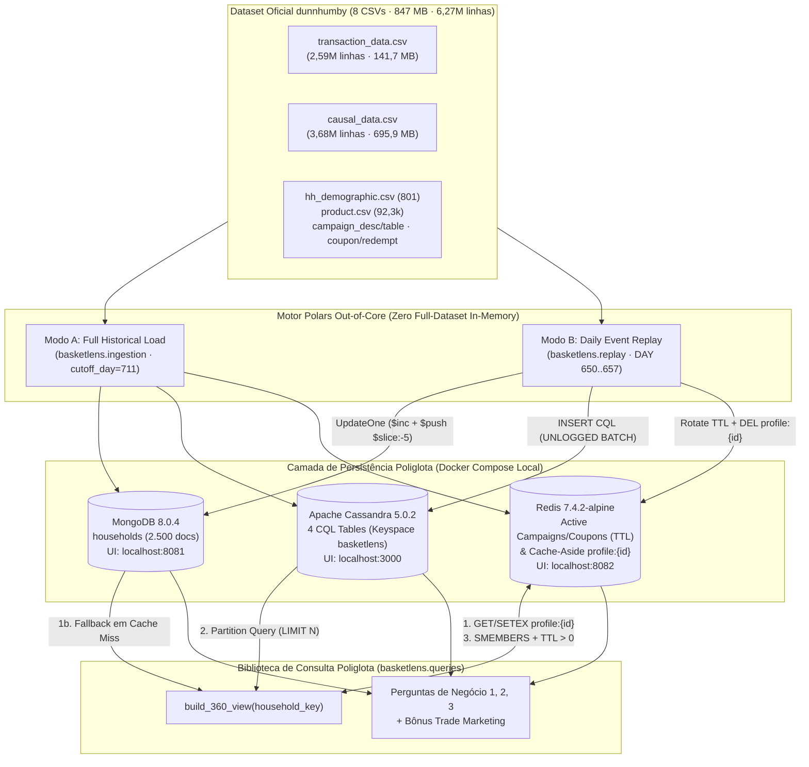
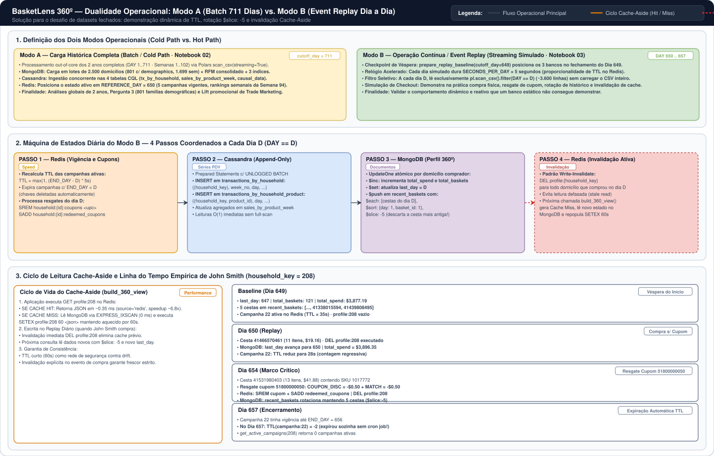
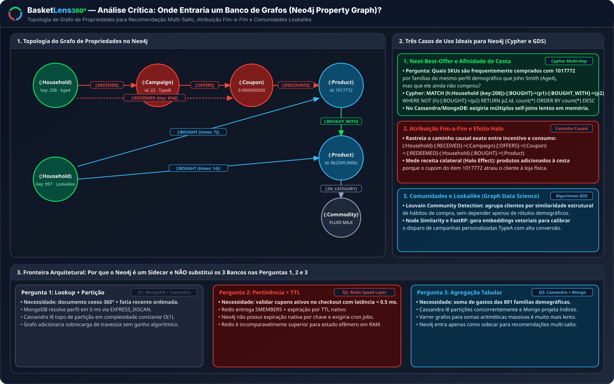
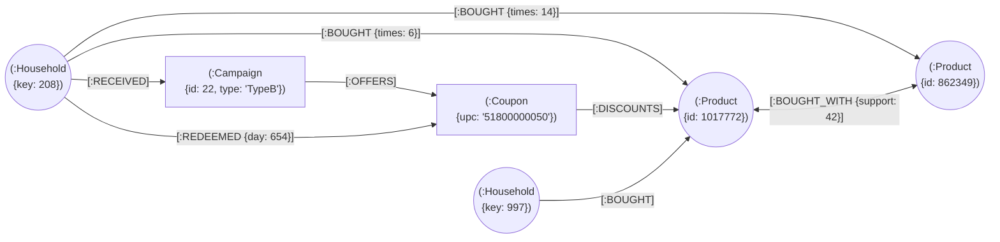
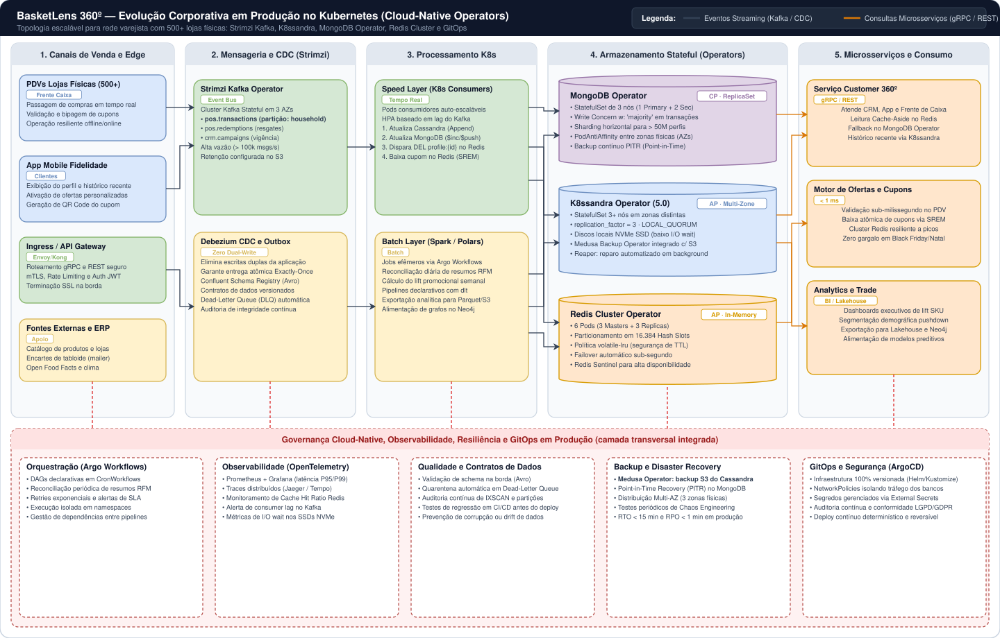

# BasketLens 360º — Arquitetura Poliglota, Modelagem NoSQL e Análise Crítica

> **Entregável Oficial — Aulas 6 e 8 (Arquitetura e Modelagem Justificadas + Análise Crítica)**
> **Disciplina:** Big Data e NoSQL: Soluções de Armazenamento Inovadoras (BDDB)
> **Professor:** Prof. Msc. Pedro Ernesto da Silva Souza
> **Case 7:** Fidelidade *dunnhumby — The Complete Journey* (Visão 360º do Cliente com MongoDB, Apache Cassandra e Redis)

---

## 1. Visão Geral da Arquitetura Poliglota

  

O **BasketLens** implementa uma arquitetura de **Persistência Poliglota** para varejo alimentar físico com programa de fidelidade, combinando três motores NoSQL de famílias distintas (**Documental**, **Colunar Larga** e **Chave-Valor em Memória**) orquestrados por uma camada de ingestão e consulta *out-of-core* em Python + **Polars**. O diagrama acima estrutura o fluxo fim-a-fim em **5 raias arquiteturais** acompanhadas por uma **camada transversal de observabilidade**:

1. **Fontes de Dados (Data Sources):** Os 8 arquivos CSV oficiais do dataset *dunnhumby — The Complete Journey* (~847,05 MB · 6.274.384 linhas · 2.500 domicílios · 711 dias / 102 semanas).
2. **Ingestão & Processamento Out-of-Core:** Motor Python + **Polars** operando em dois modos complementares — **Modo A** (`basketlens.ingestion` via `scan_csv(streaming=True)` e `read_csv_batched` até `cutoff_day = 711`) e **Modo B** (`basketlens.replay` simulando o avanço diário `DAY 650..657` com `SECONDS_PER_DAY = 5`).
3. **Armazenamento Poliglota NoSQL (Storage Layer):**
   - **MongoDB 8.0.4 (CP — Documentos BSON, `:27017`):** Coleção `households` (2.500 documentos, sendo 801 com `demographics` e 1.699 sem `demographics`), consolidando `behavior_summary` (RFM), `recent_baskets` (`$slice: -5`) e 3 índices B-Tree (`IXSCAN`).
   - **Apache Cassandra 5.0.2 (AP — Colunas Largas, `:9042`):** Keyspace `basketlens` com 4 tabelas orientadas à consulta (`transactions_by_household`, `transactions_by_household_product`, `sales_by_product_week` e `causal_promotions_by_store_week`).
   - **Redis 7.4.2-alpine (AP — Chave-Valor em RAM, `:6379`):** Hashes e Sets de campanhas/cupons ativos com `TTL` dinâmico, Cache-Aside de perfis (`profile:{id}` com `SETEX`/`DEL`) e vitrines semanais (`ranking:week:{w}`, `store:{id}:week:{w}:displays`).
4. **Serviço & Inteligência Poliglota (`basketlens.queries`):** Orquestra a Visão 360º (`build_360_view(household_key)`) e as consultas analíticas das Perguntas de Negócio 1, 2, 3 e Bônus de Trade Marketing.
5. **Consumo & Entregáveis:** Os 4 Jupyter Notebooks executáveis (`01` a `04`), a suíte automatizada E2E (`pytest`) e a documentação executiva.
6. **Camada Transversal de Observabilidade & Governança Visual:** Inspeção em tempo real via **mongo-express** (`http://localhost:8081`), **cassandra-web** (`http://localhost:3000`), **redis-commander** (`http://localhost:8082`) e telemetria estruturada via **Loguru**.

### 1.1 Diagrama Mermaid da Arquitetura Integrada

### 1.2 Racional de Escolha por Família NoSQL

| Banco | Família NoSQL | Papel Arquitetural no BasketLens | Fonte da Verdade (*System of Record*)? | Justificativa Técnica |
|:---|:---|:---|:---|:---|
| **MongoDB (`mongo:8.0.4`)** | Documentos (BSON) | **Agregado do Perfil 360º (`households`)**: demografia, resumo comportamental RFM (`behavior_summary`), 5 últimas cestas enriquecidas (`recent_baskets`) e histórico de campanhas recebidas. | **Sim**, para o perfil consolidado do domicílio. | O perfil 360º é lido como uma unidade coesa na tela de atendimento/CRM. Além disso, apenas 801 de 2.500 famílias possuem atributos demográficos — o modelo documental acomoda essa heterogeneidade com **polimorfismo** nativo sem `ALTER TABLE` nem dezenas de colunas `NULL`. |
| **Apache Cassandra (`cassandra:5.0.2`)** | Colunas Largas (*Wide-Column*) | **Série Temporal de Transações e Dados Causais**: 2,59M itens comprados e 36,78M registros de exposição em gôndola/tabloide (`causal_data`). | **Sim**, para os eventos imutáveis de compra e promoção física. | Transações de PDV e auditoria de gôndola são *append-only* de altíssimo volume. A modelagem orientada à consulta (chave de partição + *clustering order* decrescente) entrega leituras por domicílio/período ou loja/semana em complexidade constante `O(1)` por partição. |
| **Redis (`redis:7.4.2-alpine`)** | Chave-Valor em Memória (*Speed Layer*) | **Motor de Elegibilidade em Tempo Real e Cache-Aside**: campanhas e cupons vigentes com **TTL** nativo, cache do perfil (`profile:{id}`) e vitrines semanais (`ZSET`/`SET`). | **Não** — atua como camada de velocidade (*Speed Layer*). | No checkout do PDV ou abertura do app, validar se um cupom está ativo exige latência sub-milissegundo e expiração automática gerenciada pelo próprio banco via `EXPIRE`/`TTL`, sem *cron jobs* de limpeza. |

---

## 2. Dualidade Operacional: Modo A (Full Historical Load) vs. Modo B (Daily Event Replay)

  

Um desafio clássico ao trabalhar com datasets históricos fechados (`DAY` 1 a 711) é demonstrar o comportamento dinâmico de uma arquitetura de varejo em tempo real (expiração de TTL, invalidação de cache e rotação das últimas cestas). Para resolver isso com rigor de engenharia, o **BasketLens** opera em **dois modos complementares**:

- **Modo A — Carga Histórica Completa (Cold Path / Batch · Notebook 02):**
  - Processa os 2 anos completos (`DAY 1..711` · Semana `1..102`) via Polars `scan_csv(..., streaming=True)` e `read_csv_batched`.
  - Popula os 2.500 domicílios na coleção `households` do MongoDB, as 4 tabelas CQL no Cassandra e o estado de referência (`REFERENCE_DAY = 650`) no Redis.
  - **Finalidade:** Análises globais de 2 anos, Pergunta 3 (801 famílias com demografia) e Lift promocional de Trade Marketing.
- **Modo B — Event Replay Dia a Dia (Hot Path / Streaming Simulado · Notebook 03):**
  - Inicializa o baseline determinístico na véspera (`prepare_replay_baseline(cutoff_day = 649)`).
  - Avança o relógio operacional dia a dia (`DAY = 650, 651, ..., 657`) com `SECONDS_PER_DAY = 5`.
  - A cada dia `D`, extrai via `pl.scan_csv().filter(pl.col("DAY") == D)` apenas os eventos daquele dia:
    1. **Redis:** Atualiza o `TTL` das campanhas ativas, expira campanhas encerradas (a Campanha 22 expira após `DAY 656`) e processa resgates do dia (como o cupom `51800000050` resgatado pelo domicílio `#208` no Dia 654).
    2. **Cassandra:** Insere as compras do dia `D` em `transactions_by_household` e `transactions_by_household_product`, além de atualizar `sales_by_product_week`.
    3. **MongoDB:** Incrementa `total_spend` e `total_baskets` (`$inc`) e empurra as novas cestas em `recent_baskets` mantendo estritamente as 5 mais recentes (`$push` + `$slice: -5`).
    4. **Redis (Cache Invalidation):** Invalida imediatamente o cache (`DEL profile:{id}`) dos domicílios que realizaram compras ou resgates no dia.

### Regra Estrita *Zero Full-Dataset In-Memory*
Em ambos os modos, **nenhum módulo carrega `transaction_data.csv` (141,7 MB) ou `causal_data.csv` (695,9 MB) inteiros em memória**:
- Em `basketlens.ingestion`, utilizam-se `pl.scan_csv(...).collect(streaming=True)` e `pl.read_csv_batched(..., batch_size=50_000)`.
- Em `basketlens.replay`, cada passo diário filtra na origem `pl.scan_csv(...).filter(pl.col("DAY") == day).collect(streaming=True)`, trazendo apenas ~3.600 linhas por dia.
- Em `basketlens.queries`, **nenhum arquivo CSV é lido**: 100% das consultas fazem *pushdown* direto aos índices do MongoDB, às chaves de partição do Cassandra e às estruturas em memória do Redis.

---

## 3. Justificativa Detalhada de Modelagem por Banco

### 3.1 MongoDB — Coleção `households` (Padrões de Modelagem e Índices)

A coleção `households` armazena exatamente **2.500 documentos** (1 para cada `household_key` ativo no programa de fidelidade) e combina quatro padrões clássicos de modelagem documental:

1. **Polymorphic Schema (Esquema Polimórfico):**
   - Apenas **801 domicílios** possuem registro em `hh_demographic.csv`. Seus documentos contêm o subdocumento aninhado `demographics` com as 5 variáveis ordinais oficiais do guia da dunnhumby (`classification_1` a `classification_5`, `homeowner_desc`, `kid_category_desc`) e seus aliases semânticos (`age_group`, `marital_code`, `income_level`, `household_size`, `hh_comp_group`).
   - Os **1.699 domicílios restantes** **omitem** completamente a chave `demographics` (sem campos `NULL`), preservando `behavior_summary`, `recent_baskets` e `campaigns_received`.
2. **Subset Pattern (`recent_baskets` com `$slice: -5`):**
   - Um domicílio assíduo pode acumular centenas de cestas e milhares de itens ao longo de 2 anos. Embutir todo o histórico violaria o princípio de documentos enxutos e se aproximaria do limite de 16 MB do BSON em cenários de longo prazo.
   - Por isso, `recent_baskets` armazena **apenas as 5 ocasiões de compra mais recentes** do domicílio. No Modo B (*Event Replay*), cada nova cesta é inserida com `$push: {"recent_baskets": {"$each": new_baskets, "$sort": {"day": 1, "basket_id": 1}, "$slice": -5}}`, descartando automaticamente a cesta mais antiga.
3. **Extended Reference Pattern (`items[]` enriquecidos):**
   - Cada item dentro de `recent_baskets` embute `product_id`, `commodity_desc` e `department` copiados de `product.csv` no momento da ingestão/replay, evitando `$lookup` (*join*) em tempo de leitura da Visão 360º.
4. **Computed / Summary Pattern (`behavior_summary`):**
   - Consolida métricas pré-calculadas (`total_spend`, `total_baskets`, `active_weeks`, `avg_basket_value`, `avg_weekly_spend`, `first_day`, `last_day`, `top_departments`, `top_commodities`), atualizadas incrementalmente via `$inc` e `$max` a cada compra.

#### Estratégia de Indexação no MongoDB
Três índices B-Tree secundários garantem que todas as consultas operem via `IXSCAN` / `EXPRESS_IXSCAN` (zero `COLLSCAN`):
- `idx_household_key_unique`: `{ "household_key": 1 }` (`unique: true`) — busca pontual `O(log N)` do perfil 360º.
- `idx_demographics_class1_class3`: `{ "demographics.classification_1": 1, "demographics.classification_3": 1 }` — acelera a projeção segmentada das 801 famílias na Pergunta 3.
- `idx_behavior_avg_weekly_spend_desc`: `{ "behavior_summary.avg_weekly_spend": -1 }` — ordenação instantânea de clientes VIP por gasto semanal médio.

---

### 3.2 Apache Cassandra — Modelagem Orientada à Consulta (4 Tabelas CQL)

No Cassandra, a modelagem parte das consultas (*Query-Driven Modeling*): **uma tabela por padrão de acesso**, desnormalizando os dados intencionalmente para que toda consulta forneça a `PARTITION KEY` completa e **jamais utilize o antipadrão `ALLOW FILTERING`**.

| Tabela CQL | Chave Primária (`PRIMARY KEY`) | `CLUSTERING ORDER BY` | Consulta Atendida e Justificativa Técnica |
|:---|:---|:---|:---|
| `transactions_by_household` | `((household_key), week_no, day, basket_id, product_id)` | `week_no DESC, day DESC, basket_id DESC, product_id ASC` | **Pergunta 1 e Pergunta 3:** Todas as compras de um domicílio ficam na mesma partição física (`household_key`) e já estão fisicamente ordenadas em disco da semana/dia mais recente para o mais antigo. Um `SELECT ... WHERE household_key = 208 LIMIT 20` lê apenas o topo da *SSTable* em poucos milissegundos. |
| `transactions_by_household_product` | `((household_key, product_id), day, basket_id)` | `day DESC, basket_id DESC` | **Histórico de Recompra por Produto:** Quando a pergunta filtra por cliente **e** produto específico (ex.: compras do item `1017772` por John Smith `#208`), a tabela anterior exigiria varrer toda a partição do cliente. A chave de partição composta `(household_key, product_id)` isola o histórico exato daquele SKU naquele domicílio em `O(1)`. |
| `sales_by_product_week` | `((product_id), week_no)` | `week_no DESC` | **Desempenho Semanal de SKU (Trade Marketing):** Agrega `total_units`, `total_sales` e `total_baskets` por `product_id` ao longo das semanas (`week_no`), permitindo consultar a curva de vendas do produto `72717` ou `862349` sem varrer domicílios. |
| `causal_promotions_by_store_week` | `((store_id, week_no), product_id)` | `product_id ASC` | **Auditoria de Gôndola e Tabloide (`causal_data.csv` — 695,9 MB):** A chave composta `(store_id, week_no)` agrupa todos os produtos promovidos em uma loja em determinada semana na mesma partição. As colunas `display_type` e `mailer_page` são tipadas como `text` porque o dataset utiliza códigos alfanuméricos (`'0'..'9'`, `'A'` para display; `'A'`, `'D'`, `'F'`, `'H'`, `'J'`, `'L'`, `'P'`, `'X'`, `'Z'` para mailer). |

#### Por que `ALLOW FILTERING` é proibido na nossa arquitetura?
Em um cluster Cassandra distribuído, omitir a chave de partição e forçar `ALLOW FILTERING` obriga o nó coordenador a varrer **todas as partições em todos os nós do anel**, causando alto consumo de CPU/I/O e timeouts em produção. Ao projetar 4 tabelas especializadas e usar `execute_concurrent_with_args` para buscar partições específicas em paralelo, 100% das consultas do `basketlens.queries` operam sem `ALLOW FILTERING`.

---

### 3.3 Redis — Estrutura de Chaves, TTL Alinhado à Vigência e Cache-Aside

Seguindo a convenção canônica `objeto:id` da disciplina, o Redis armazena 7 padrões de chaves:

| Padrão de Chave | Tipo Redis | TTL Aplicado | Papel na Arquitetura |
|:---|:---|:---|:---|
| `campanha:{campaign}` | `HASH` | `max(1, (END_DAY - ref_day) * SECONDS_PER_DAY)` | Metadados da campanha ativa (`description`, `type`, `start_day`, `end_day`, `reference_day`). Expira sozinho ao fim da vigência. |
| `campanha:{campaign}:coupons` | `SET` | Mesmo TTL da campanha | Conjunto de `COUPON_UPC` pertencentes à campanha ativa. |
| `cupom:{coupon_upc}` | `HASH` | Mesmo TTL da campanha | Regras do cupom (`campaign`, `product_id`, `product_count`, `redemptions_count`). |
| `household:{id}:campaigns` | `SET` | Maior TTL entre as campanhas do domicílio | Conjunto de campanhas ativas para as quais o domicílio é elegível. |
| `household:{id}:coupons` | `SET` | Maior TTL entre as campanhas do domicílio | Conjunto de cupons disponíveis para resgate pelo domicílio (removidos via `SREM` no momento do resgate). |
| `profile:{household_key}` | `STRING` | `60s` (`SETEX`) + Invalidação ativa (`DEL`) | JSON serializado do perfil 360º do MongoDB sob o padrão **Cache-Aside**. |
| `ranking:week:{w}` / `store:{id}:week:{w}:displays` | `ZSET` / `SET` | `3600s` | Top commodities da semana por receita (`ZSET`) e vitrine física de produtos em display na loja (`SET`). |

#### Ciclo Completo do Cache-Aside (`profile:{household_key}`)
1. **Leitura (`build_360_view`)**: Executa `GET profile:{id}` no Redis.
2. **Cache Hit**: Retorna o JSON diretamente da memória RAM em sub-milissegundo (`source = "redis"`).
3. **Cache Miss**: Consulta `db.households.find_one({"household_key": id})` no MongoDB via índice único e popula o Redis com `SETEX profile:{id} 60 <json>` (`source = "mongodb"`).
4. **Invalidação em Escrita (`replay_day`)**: Sempre que o domicílio realiza uma compra ou resgata um cupom no dia simulado, o motor executa `DEL profile:{id}`, evitando leitura de dados defasados (*stale read*).

---

## 4. Matriz de Decisão: Teorema CAP e Consistência Ajustável

| Banco | Família | Classificação CAP | Configuração de Consistência | Racional de Negócio e Trade-off |
|:---|:---|:---|:---|:---|
| **MongoDB** | Documentos | **CP** (*Consistency + Partition Tolerance*) | Escrita primária com `w: 1` (ou `w: "majority"` em ReplicaSet) e leitura no primário | O documento `households` representa o cadastro e os indicadores consolidados do cliente. Escritas concorrentes de atualização de cesta (`$inc` / `$push`) precisam ser atômicas por documento para não corromper o vetor `recent_baskets`. |
| **Apache Cassandra** | Colunas Largas | **AP** (*Availability + Partition Tolerance*) com consistência ajustável (*Tunable Consistency*) | **Leitura Analítica:** `ONE` **Escrita Operacional / Reprocessamento:** `ONE` (single-node dev) / `LOCAL_QUORUM` (produção 3 nós, `R + W > N`) | No PDV de supermercado, **disponibilidade de escrita é inegociável** (o caixa nunca pode parar de registrar vendas por falha de rede parcial). Para séries históricas imutáveis e agregações analíticas (Pergunta 3), `ONE` maximiza vazão e reduz latência; em cluster de produção com `replication_factor = 3`, `LOCAL_QUORUM` garante leitura consistente imediata (*read-your-writes*). |
| **Redis** | Chave-Valor | **AP** (Baixa Latência em Memória) | Consistência **Eventual** com invalidação explícita (`DEL`) e expiração temporal (`TTL`) | Exibir uma vitrine semanal ou o cache do perfil com poucos segundos de defasagem tem custo de negócio próximo de zero, enquanto responder em `< 1 ms` no checkout é crítico. Para resgates de cupons, o `SREM` em `household:{id}:coupons` é atômico em memória e o registro definitivo persiste no log transacional. |

---

## 5. Análise Crítica

### 5.1 *"Onde entraria um banco de Grafos (Neo4j)?"*

  

Embora MongoDB, Cassandra e Redis atendam integralmente às necessidades de **perfil**, **série temporal de transações** e **elegibilidade em tempo real**, um quarto motor orientado a **Grafos de Propriedades (Neo4j)** entraria como **sidecar analítico de recomendação e atribuição** sempre que a pergunta de negócio dependesse de **travessia multi-salto (*multi-hop traversal*)** sobre relacionamentos:

#### Três Casos de Uso Ideais para o Neo4j no Contexto dunnhumby:
1. **Afinidade de Cesta e *Next-Best-Offer* (`BOUGHT_WITH`):**
   - Consulta Cypher: *"Quais produtos são frequentemente comprados na mesma cesta que o item `1017772` por famílias do mesmo perfil que John Smith (`208`), mas que ele ainda não experimentou?"*
   - No Cassandra ou MongoDB, descobrir co-ocorrências de 2º e 3º grau exigiria múltiplos *self-joins* proibitivos em memória. No Neo4j, é uma travessia local `O(k)` a partir do nó `(:Household {key: 208})`.
2. **Atribuição Fim-a-Fim de Campanhas (`RECEIVED -> OFFERS -> REDEEMED -> BOUGHT`):**
   - Permite rastrear o caminho completo entre o recebimento da campanha (`TypeA` personalizada vs. `TypeB` engatilhada), o resgate do cupom `51800000050` no Dia 654 e o efeito de transbordamento (*halo effect*) sobre outras categorias compradas na mesma cesta `41531980403`.
3. **Comunidades e *Lookalike Audiences* (Algoritmos GDS — Louvain / PageRank / Node Similarity):**
   - Identificar clusters de domicílios com hábitos de compra estruturalmente semelhantes para calibrar o disparo das campanhas `TypeA`.

#### Por que o Neo4j NÃO foi necessário para as 3 perguntas obrigatórias?
As três perguntas obrigatórias do enunciado são problemas clássicos de:
1. **Busca pontual de agregado + fatia ordenada por chave** (Pergunta 1 → MongoDB + Cassandra);
2. **Pertinência em conjunto com expiração temporal** (Pergunta 2 → Redis `SMEMBERS` + `TTL`);
3. **Agregação numérica agrupada por atributo dimensional** (Pergunta 3 → Cassandra *partition scan* + MongoDB *indexed projection*).

Nenhuma delas envolve caminhos de comprimento variável ou análise topológica de rede; introduzir um grafo para respondê-las adicionaria complexidade operacional sem ganho algorítmico.

---

### 5.2 Limitações da Solução Atual e Riscos Conhecidos

1. **Cobertura Demográfica Parcial (801 de 2.500 domicílios):**
   - A base oficial `hh_demographic.csv` contempla apenas 32,04% dos clientes. Qualquer segmentação demográfica (Pergunta 3) reflete estritamente esse subconjunto de 801 famílias, não podendo ser extrapolada sem ponderação amostral para as 1.699 famílias sem demografia.
2. **Consistência Eventual entre Bancos (*Dual-Write / Polyglot Drift*):**
   - No motor local `basketlens.replay`, a aplicação Python coordena sequencialmente a escrita no Cassandra, no MongoDB e a invalidação no Redis. Em caso de falha abrupta no meio do ciclo diário, poderia ocorrer *drift* temporário entre `behavior_summary` (MongoDB) e a soma bruta de `transactions_by_household` (Cassandra). Mitigamos isso tornando todas as operações idempotentes e fornecendo o checkpoint determinístico `prepare_replay_baseline`.
3. **Eixo Temporal Relativo (`DAY 1..711`):**
   - O dataset não traz timestamps ISO/UTC reais, exigindo a ancoragem em um `REFERENCE_DAY` (`650`) e fator de compressão (`SECONDS_PER_DAY`) para materializar a semântica de tempo real no Redis.

---

### 5.3 Evolução para Produção Corporativa em Kubernetes (K8s)

  

Para elevar o **BasketLens** do ambiente Docker Compose local (single-node por banco) para uma operação real de uma rede varejista com 500+ lojas físicas e milhões de clientes, a arquitetura evolui para o **Kubernetes Operator Pattern**:

1. **Eliminação de *Dual-Write* via Kafka (Strimzi Kafka Operator):** Os PDVs publicam eventos nos tópicos Kafka `pos.transactions` e `pos.redemptions`; consumidores idempotentes via Change Data Capture (Outbox/CDC) atualizam o Cassandra, o MongoDB e invalidam o Redis de forma assíncrona, desacoplada e com *retry* garantido.
2. **Alta Disponibilidade e Consistência Real (`RF = 3`):**
   - **K8ssandra Operator:** StatefulSet de 3+ nós em zonas de disponibilidade distintas com `replication_factor = 3` (`RF = 3`) e leituras/escritas em `LOCAL_QUORUM`, suportadas por discos NVMe Local SSD e backups incrementais no S3 via *Medusa*.
   - **MongoDB Kubernetes Operator:** ReplicaSet de 3 membros (1 Primary, 2 Secondaries) com `PodAntiAffinity`, *failover* automático e escrita `w: "majority"`.
   - **Redis Cluster Operator:** 6 pods (3 *masters* + 3 réplicas) com particionamento em 16.384 *hash slots*, Sentinel Failover e política `volatile-lru`.
3. **Orquestração Declarativa (Argo Workflows + `dlt`):** Jobs periódicos de reconciliação de resumos (`behavior_summary`), processamento distribuído em Polars/Spark e enriquecimento externo (Open Food Facts / Open-Meteo) rodam em pods efêmeros orquestrados por `CronWorkflow` no Argo Workflows, mantendo governança GitOps fim a fim.
